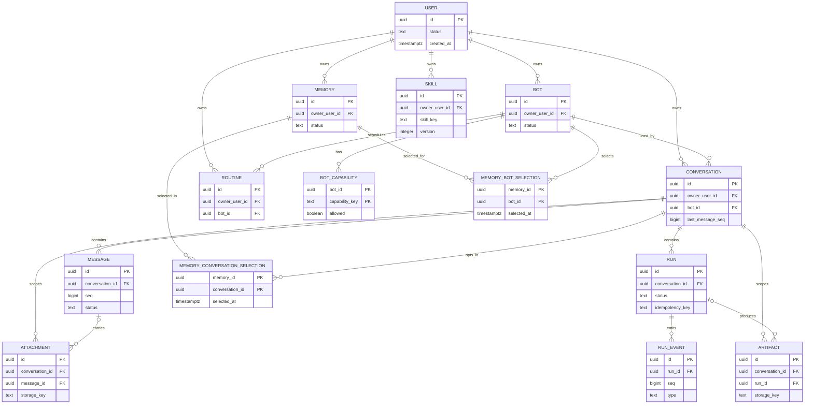

# Habi Object and Context Model — Design

- **Status:** **Design approved by the owner at planning fidelity on 2026-10-23; this revision is prepared for user-authorized publication on 2026-10-28.** Local planning acceptance is recorded. The document is **not merged**, and no runtime, security, implementation, schema, or P0 acceptance is implied. Remote H-002 acceptance recording is **pending after publication**: issue #2 is currently CLOSED on GitHub with no published acceptance record or checklist evidence. Recording acceptance there belongs to the owner/parent. Design contracts below are approved; downstream implementation choices remain deferred.
- **Date:** 2026-10-22; owner decisions and design approval added 2026-10-23
- **Phase:** P0 — Feasibility (H-002)
- **Scope:** Persistence-neutral object/context vocabulary, then a PostgreSQL mapping and index plan. Design only.
- **Authority:** [issue #2](https://github.com/daryllmagsombol/habi-bot/issues/2), the accepted [H-001 boundary](2026-10-21-poc-boundary-and-journeys-design.md), repository security rules ([README.md:158-172](https://github.com/daryllmagsombol/habi-bot/blob/main/README.md#L158-L172)), and downstream requirements in [#16](https://github.com/daryllmagsombol/habi-bot/issues/16), [#19](https://github.com/daryllmagsombol/habi-bot/issues/19), [#20](https://github.com/daryllmagsombol/habi-bot/issues/20), [#22](https://github.com/daryllmagsombol/habi-bot/issues/22), and [#32](https://github.com/daryllmagsombol/habi-bot/issues/32).
- **Prior research:** [preliminary constraints note](../research/2026-10-21-object-model-and-auth-constraints.md).

This document labels statements as **Mandated** (issue/README requires it), **Owner-approved design** (recorded below), or **Deferred** (downstream implementation choice, not a design blocker). Historical review provenance is preserved in §22. No numeric product limits, provider choice, registration mode, or auth/session design are introduced.

## Owner decisions — 2026-10-23

These are recorded owner decisions. They shape the design but do **not by themselves close H-002**, pass P0, or prove runtime behavior.

| Decision | Requirement | Boundary |
|---|---|---|
| D1. Bot removal with conversations | Removing a Bot that has conversations **archives** it. Readable conversation history and replay remain available to the owner; no new runs may start; memory recall through that Bot is denied. Deleting history is a **separate explicit action**. Archive is not erasure or account deletion. | Retention, restore, purge, and hard-delete policy are **not decided** here. |
| D2. Memory recall approval | Recall requires **both** per-Bot approval and per-conversation approval; both default off. | Selection UX and ranking remain downstream. |
| D3. Memory source deletion | An explicitly saved, accepted Memory **survives** deletion of its source conversation: its provenance is nulled or tombstoned and an audit record is written. The user may then delete it explicitly. Explicit memory deletion or account deletion removes it. | Source deletion must not silently erase accepted memories; no implicit retention period is set. |

**Owner approval — 2026-10-23:** the owner approved all design contracts in §18, the deferrals in §21, D1–D3, and the #16/#32 AI-assisted requirements review. This records **planning acceptance only** and authorizes preparing this document for publication, not implementation. At approval time publication was held; the owner has since authorized preparation for publication. Remote H-002 acceptance is **not yet recorded**: issue #2 shows CLOSED without published acceptance evidence, so the issue-side record is pending after publication. It is not human security certification, runtime verification, or a passed P0 gate. The independent reviewer did not re-review the orchestrator’s later corrections; the orchestrator checked them. Mermaid rendering was unavailable.

Implementation choices in §21 remain deferred; they are not conditions for this design approval.

## 1. Scope and non-goals

In scope: canonical entities, ownership and visibility, effective capability, Run and Message lifecycles, event replay, stable ordering, memory/attachment/artifact scope, JSONB boundary, PostgreSQL tables/indexes, queue envelope, and deletion/export implications.

Out of scope: SQL DDL or migrations, ORM choice, API/UI design, auth architecture (#8), provider/Hermes selection (#3/#4), numeric quotas or retention, attachment extraction (#27), artifact generation (#28), memory recall ranking (#30), skill execution (#31), and routine execution (#34).

**Explicit non-goals from #2:** no second database, no Redis/NoSQL, no team/public-sharing/connector modeling, no generic workspace abstraction that weakens isolation, and no JSONB authorization boundary.

## 2. Invariants

1. **One PostgreSQL database.** Relational data, messages, and JSONB metadata only ([README.md:186-193](https://github.com/daryllmagsombol/habi-bot/blob/main/README.md#L186-L193)). *Mandated.*
2. **Owner chain everywhere.** Every user-visible row resolves to exactly one owning user; child rows repeat `owner_user_id` where needed for authorization queries. *Mandated by #2/#16.*
3. **Default deny.** Missing or mismatched ownership denies. *Mandated.*
4. **IDs are not authorization.** Opaque IDs are stable handles only; every access checks the owner chain. *Mandated.*
5. **Conversation isolation.** A conversation is readable only by its owner, even when the same Bot is used. *Mandated.*
6. **Bot Markdown is data, not policy.** Effective capability is computed from user identity, the Bot allow-list, and conversation context. *Mandated.*
7. **JSONB is never authoritative for access.** Owner/scope columns are relational. *Mandated.*
8. **Ordering is server-assigned.** No wall-clock-only ordering for messages or events. *Mandated.*
9. **No silent capability from context.** Context can only narrow capability, never expand it. *Owner-approved design interpretation.*
10. **Deletion invalidates access immediately.** Stale IDs, storage keys, and event cursors must not keep returning data. *Mandated by #16/#32.*

## 3. Entity catalog

### 3.1 Ownership and lifecycle summary

| Entity | Purpose | Owner / parent | Stable ID | Lifecycle | Deletion |
|---|---|---|---|---|---|
| User | Tenancy root and identity reference | Self | `uuid` | `active`, `disabled`, `deleted` (auth detail #8) | Tombstone then purge per #32; backups deferred |
| Bot | User-owned configuration; instructions are untrusted | `owner_user_id` → User | `uuid` | `active`, `archived` (D1) | Removal with conversations archives; history preserved; new runs/recall denied; history deletion is separate; hard-delete/purge **Deferred** |
| BotCapability | Explicit allow-list row for one capability key | Parent Bot | `(bot_id, capability_key)` | Row exists or not; `allowed` flag | Cascade only on hard delete; archive preserves |
| Conversation | Private message/run thread under one Bot | `owner_user_id`, `bot_id` | `uuid` | `active`, `archived`, `deleted` (#19) | Soft delete then purge per retention policy |
| Message | Ordered turn in a conversation | `conversation_id`; owner repeated | `uuid` | `pending`, `final`, `failed`, `deleted` | Cascade/tombstone with conversation |
| Run | One restricted execution request | `conversation_id`; owner repeated | `uuid` | See §7 | Terminal audit retained until conversation purge; retention details deferred |
| RunEvent | Durable ordered event for replay | Parent Run | `uuid` | Immutable; retained per run policy | Cascade/retention with Run |
| Attachment | Untrusted uploaded object scoped to conversation | `conversation_id`; owner repeated | `uuid` | `pending`, `ready`, `rejected`, `deleted` | Deny download; delete row + storage object |
| Artifact | Generated downloadable output | `conversation_id`, optional `run_id` | `uuid` | `pending`, `ready`, `deleted` | Deny download; delete row + storage object |
| Memory | User-accepted fact | `owner_user_id` | `uuid` | `active`, `deleted` | Tombstone; Bot and conversation selections cascade |
| MemoryBotSelection | Per-Bot recall gate | Parent Memory + Bot | `(memory_id, bot_id)` | Row exists or not | Cascade with Memory or Bot |
| MemoryConversationSelection | Per-conversation recall gate | Parent Memory + Conversation | `(memory_id, conversation_id)` | Row exists or not | Cascade with Memory or Conversation |
| Skill | Versioned Markdown guidance (P2) | `owner_user_id` | logical `(owner_user_id, skill_key, version)`; row `uuid` | `active`, `deleted`; versions immutable | Tombstone; no execution model here |
| Routine | Schedule definition (P3 only) | `owner_user_id`, `bot_id` | `uuid` | `enabled`, `disabled`, `deleted` | Disable then tombstone |

**Workspace:** this draft proposes **no workspace table**. Issue #2 prohibits a generic workspace abstraction that silently weakens isolation, not every possible workspace; adding one would need separate justification. Treating User as the tenancy root is a proposal, not an issue mandate. BYO provider connections are an accepted product goal ([H-001 note:69-71](2026-10-21-poc-boundary-and-journeys-design.md)) but their entity belongs to provider/auth design, not this gate.

### 3.2 Field dictionary

| Entity | Field | Meaning and constraint |
|---|---|---|
| User | `id` | Opaque UUID primary key. |
| User | `status` | Account state; auth/session mechanics owned by #8/#17. |
| User | `created_at`, `updated_at`, `deleted_at` | Server timestamps; `deleted_at` marks tombstone. |
| Bot | `id`, `owner_user_id` | PK and owning user FK. |
| Bot | `name`, `description`, `avatar_ref` | Display/config metadata; `avatar_ref` is a reference, not an auth key. |
| Bot | `instructions_markdown` | Untrusted guidance; never parsed into permissions. |
| Bot | `status`, `created_at`, `updated_at`, `deleted_at` | `active` or `archived` (D1); archive preserves history and denies new runs/recall. `deleted_at` is reserved for a separate hard-delete path, which remains **Deferred**. |
| BotCapability | `bot_id`, `capability_key` | Composite PK/FK; capability vocabulary is **Deferred** (#6/#21). |
| BotCapability | `allowed`, `created_at`, `updated_at` | Explicit allow/deny; absence means deny. |
| Conversation | `id`, `owner_user_id`, `bot_id` | PK, owner FK, Bot FK. Owner and Bot must agree at creation. |
| Conversation | `title`, `status` | User-visible title; `status` from #19. |
| Conversation | `last_message_seq` | Monotonic counter used to allocate message order. |
| Conversation | `created_at`, `updated_at`, `deleted_at` | Timestamps. |
| Message | `id`, `conversation_id`, `owner_user_id` | PK, FK, repeated owner for predicates. |
| Message | `role` | `user` or `assistant`; no arbitrary role strings. |
| Message | `content` | Final text; streaming deltas are RunEvents, not messages. |
| Message | `client_message_id` | Client-supplied idempotency key, unique per conversation when present; null for assistant-generated rows. |
| Message | `seq` | Server-assigned monotonic order, unique per conversation. |
| Message | `run_id` | Optional producing run; must belong to the same conversation. At most one assistant result per Run. |
| Message | `status` | Message lifecycle; see §9. |
| Message | `created_at`, `finalized_at`, `deleted_at` | Server timestamps. |
| Run | `id`, `owner_user_id`, `conversation_id` | PK, owner, conversation FKs. |
| Run | `idempotency_key` | Required caller key; enqueue uniqueness in §7.3. |
| Run | `request_fingerprint` | Canonical request hash used to detect key reuse with different payload. |
| Run | `status` | §7 state machine. |
| Run | `attempt` | Incremented on retry/reconciliation; policy #22. |
| Run | `lease_owner`, `lease_expires_at`, `heartbeat_at`, `lease_epoch` | Worker lease and monotonic fencing token; not user-visible. |
| Run | `dispatch_state` | `not_dispatched`, `dispatched`, or `unknown`; `unknown` marks ambiguous provider execution. |
| Run | `usage_budget`, `usage_status`, `usage_recorded_at` | Budget envelope; `usage_status` is `known`, `partial`, or `unknown`; values **Deferred** (#3/#22). |
| Run | `terminal_outcome` | Final classification; may be `completed`, `failed`, `cancelled`, `timed_out`, or `execution_uncertain`. |
| Run | `capability_snapshot` | Audit-only JSONB of computed capability; never re-used as authority without recomputation. |
| Run | `created_at`, `started_at`, `finished_at`, `updated_at` | Server timestamps. |
| RunEvent | `id`, `run_id`, `owner_user_id`, `conversation_id` | PK, run FK, repeated scope for replay queries. |
| RunEvent | `seq` | Monotonic per run; unique with `run_id`. |
| RunEvent | `type` | Event type vocabulary owned by #20. |
| RunEvent | `payload` | JSONB; no secrets or full prompts by default. |
| RunEvent | `created_at` | Server timestamp; ordering uses `seq`. |
| Attachment | `id`, `owner_user_id`, `conversation_id` | PK and scope FKs. |
| Attachment | `message_id` | Optional parent message; must be in the same conversation. |
| Attachment | `storage_key`, `filename`, `content_type`, `byte_size`, `checksum` | Object reference and metadata; limits **Deferred** (decision 3). |
| Attachment | `status`, `created_at`, `deleted_at` | Validation lifecycle and timestamps. |
| Artifact | `id`, `owner_user_id`, `conversation_id`, `run_id` | PK and scope; `run_id` optional but must match conversation. |
| Artifact | `kind`, `storage_key`, `content_type`, `byte_size` | Output metadata; formats owned by #28. |
| Artifact | `status`, `created_at`, `deleted_at` | Lifecycle and timestamps. |
| Memory | `id`, `owner_user_id`, `fact_text` | PK, owner, accepted fact. |
| Memory | `source_conversation_id`, `source_message_id` | Provenance; same owner and same conversation; nullable. |
| Memory | `status`, `accepted_at`, `accepted_by`, `created_at`, `updated_at`, `deleted_at` | User acceptance and audit fields; `accepted_by` must equal the owner in the POC. |
| MemoryBotSelection | `memory_id`, `bot_id` | Composite PK; per-Bot recall gate. |
| MemoryBotSelection | `selected_at`, `selected_by` | Audit; selecting user must own the memory and Bot. |
| MemoryConversationSelection | `memory_id`, `conversation_id` | Composite PK; per-conversation recall gate, default off. |
| MemoryConversationSelection | `selected_at`, `selected_by` | Audit; selecting user must own the memory and conversation. |
| Skill | `id`, `owner_user_id`, `skill_key`, `name`, `version` | Row `id` is internal; logical stable identity is `(owner_user_id, skill_key, version)`, unique. |
| Skill | `instructions_markdown`, `status`, `created_at`, `deleted_at` | Markdown guidance; P2 only. |
| Routine | `id`, `owner_user_id`, `bot_id` | PK and scope. |
| Routine | `schedule` | JSONB schedule expression, schema-owned by #33/#34. |
| Routine | `enabled`, `next_run_at`, `status` | Scheduling metadata; P3 only, no execution design. |
| Routine | `created_at`, `updated_at`, `deleted_at` | Timestamps. |

`owner_user_id` is repeated on Message, Run, RunEvent, Attachment, and Artifact so authorization predicates do not depend on JSONB or a join-only guess. The duplication must be constraint-checked against the parent (see §13).

### 3.3 Child tables justified from requirements

- **`bot_capabilities`** — #2 requires "Bot configuration versus effective capability" and an explicit allow-list. Without a relational allow-list, capability would have to be inferred from Markdown, which the baseline forbids. Child table is justified.
- **`memory_bot_selections`** — #2 requires per-Bot memory selection. A many-to-many table is the minimal representation; absence means the Bot cannot recall the fact.
- **`memory_conversation_selections`** — H-001 requires deliberate opt-in and §10 defines recall as a conversation-scoped act. A per-conversation selection table makes that opt-in explicit and default-off, without a global memory flag.
- **`run_events`** — #2 and #20 require durable ordered events and replay. Events cannot live only in memory or a single JSONB blob because replay cursors and ordering must be queryable.

No other supporting tables are added. `BotCapability` and the memory-selection tables are authorization primitives, not user-visible entities.

## 4. ERD

*Owner-approved ERD design. Table names map below. Mermaid rendering was unavailable; syntax was reviewed manually.*

## 5. Visibility and authorization

### 5.1 Predicates

Every operation resolves these predicates server-side:

1. **Identity:** authenticated `user_id`. *Mandated.*
2. **Direct ownership:** `row.owner_user_id = user_id` where the entity has an owner column.
3. **Parent ownership:** for child rows, join to the parent and confirm the parent owner; repeated owner columns must agree.
4. **Conversation scope:** messages, runs, events, attachments, artifacts, and memory selections must resolve to an owned conversation (or owned user for memory).
5. **Bot ownership:** a Bot used by a conversation is owned by the same user; a Bot cannot be shared across owners.
6. **Capability:** request action must be in the effective capability set (§6).
7. **Ancestor lifecycle:** require an active owning account and non-deleted ancestors in states permitting the requested operation. Archived conversations remain readable and terminal Runs remain replayable. An **archived Bot** permits owner read/history/replay but denies new Runs and memory recall; archive is not erasure (D1). A tombstoned ancestor denies even when a child row remains. Hard-delete, restore, and purge behavior remain **Deferred**.
8. **Memory gates:** recall requires both a Bot selection and a conversation selection (§10).

### 5.2 Matrix

| Entity / resource | Read / download | Write / create | List / search | Delete | Guessed-ID result |
|---|---|---|---|---|---|
| User | Self only | Self only | Self only | Self (via #32) | Deny |
| Bot | Owner (active or archived) | Owner (update/archive) | Owner | Removal with conversations archives (D1); history deletion separate; hard-delete **Deferred** | Deny |
| BotCapability | Owner via Bot | Owner via Bot | Owner via Bot | Owner via Bot | Deny |
| Conversation | Owner | Owner | Owner | Owner | Deny |
| Message | Owner via conversation | Owner via conversation | Owner via conversation | Owner via conversation | Deny |
| Run | Owner via conversation (including archived Bot history) | Owner via conversation (enqueue/cancel); new enqueue denied when Bot archived | Owner via conversation | Not user-deletable (approved design) | Deny |
| RunEvent | Owner via Run/conversation | System writer only | Owner via conversation (replay) | Retention only | Deny |
| Attachment | Owner + conversation | Owner upload path | Owner + conversation | Owner + conversation | Deny |
| Artifact | Owner + conversation | System/run writer | Owner + conversation | Owner + conversation | Deny |
| Memory | Owner | Owner (accept/edit/delete) | Owner | Owner | Deny |
| MemoryBotSelection | Owner via Memory and Bot | Owner via Memory and Bot | Owner via Memory | Owner via Memory | Deny |
| MemoryConversationSelection | Owner via Memory and conversation | Owner via Memory and conversation | Owner via Memory | Owner via Memory | Deny |
| Skill | Owner | Owner | Owner | Owner | Deny |
| Routine | Owner | Owner | Owner | Owner | Deny |
| Queue job | Worker only | System only | System only | System only | Deny |
| Storage object | Never directly | System only | Never | System only | Deny |
| Harness session | Owner through server-side owner/conversation/Run mapping | Scoped adapter only | Owner-scoped adapter only | Revocation through adapter | ID alone denies |
| Cache entry | Revalidate owner/conversation before serving | System, owner/conversation-keyed | No direct client access | Invalidate on deletion | Key alone denies |
| Reconnect token | Bound to Run owner and conversation; revalidate on use | Server-issued only | No direct listing | Revoke with parent access | Token alone denies |

Harness session IDs must be mapped server-side to the owner, conversation, and associated Run before every use; adapter IDs never confer bearer authorization. Session reuse must not cross conversations. Revocation/deletion invalidates the mapping. **Approved POC boundary:** ownership transfer is unsupported; references below to ownership change specify required invalidation if a later, separately reviewed feature introduces transfer, not permission to mutate owners now.

**Allow/deny examples:**

- Allow: owner lists their conversations; same user opens a message whose conversation they own.
- Allow: owner reads/replays history for a conversation under an archived Bot (D1).
- Deny: user B requests user A's `conversation_id`, `message_id`, `run_id`, `attachment_id`, or storage key. The denial does not reveal whether the record exists.
- Deny: a new Run is enqueued through an archived Bot, or memory recall is attempted through it, even with existing selections (D1).
- Deny: user B selects user A's Bot for a conversation, even if the Bot ID was observed.
- Deny: a RunEvent cursor from another run is used; the stream endpoint checks run owner and conversation.
- Deny: a worker receives a job whose payload `owner_user_id` disagrees with the persisted Run; the job is rejected and audited.

### 5.3 Non-enumerating denial

**Owner-approved design (2026-10-23):** cross-owner and nonexistent resources return the **same not-found result** (`404`/domain `NotFound`); the server does not disclose existence, owner, or record type. Same-owner requests with invalid state (for example, archiving an already-deleted conversation) return a conflict/validation result (`409`/`422`).

HTTP status mapping remains deferred (§21); #16/#5 validate implementation. Every denial is audit-visible internally with resource type, action, and reason, but without the other user's content.

## 6. Effective capability

**Definition (mandated):** effective capability = user identity ∩ Bot allow-list ∩ selected conversation context.

| Input | Grants | Cannot do |
|---|---|---|
| User identity | Access to that user's own records | Never grants tools by itself |
| Bot allow-list | Capability keys explicitly marked allowed for the Bot | Does not grant a key absent from the list |
| Conversation context | Narrows what is available in this conversation (selected Bot, selected attachments, memory selection) | Never adds a capability key |

Rules:

- Bot Markdown is treated as untrusted text and is **not** an input to capability computation.
- Absence of a `bot_capabilities` row means deny for that key.
- Compute at API admission and again at worker dispatch; store `capability_snapshot` only for audit, never as authority.
- Conversation context may subtract (for example, no selected attachment means no attachment read), never add.
- The capability-key vocabulary is **Deferred** and owned by #6/#21; this document defines the mechanism, not the list of tool capabilities.
- An **archived Bot** grants no new-run capability: new Runs are rejected and memory recall is denied. Owner read/history/replay remains available and is an ownership decision, not a capability grant (D1).

## 7. Run lifecycle

### 7.1 States

| State | Meaning | Terminal |
|---|---|---|
| `queued` | Accepted, not leased by a worker | No |
| `running` | Worker holds a valid lease | No |
| `retry_wait` | Retryable failure; waiting for the next attempt | No |
| `completed` | Terminal success; usage status recorded (known, partial, or unknown) | Yes |
| `failed` | Terminal failure; non-retryable or retries exhausted | Yes |
| `cancelled` | Terminal user/system cancellation | Yes |
| `timed_out` | Terminal timeout | Yes |

No numeric attempt or timeout values are defined; policy belongs to #22.

**Admission (D1):** a new Run cannot be created or queued when its Bot is archived. This decision governs new-run admission only; it does not define in-flight, restore, or purge behavior.

### 7.2 Transitions

| From | To | Guard |
|---|---|---|
| `queued` | `running` | Worker acquires an unexpired lease and fencing epoch; Bot is active (D1); owner/conversation still active |
| `queued` | `cancelled` | Cancellation before dispatch |
| `queued` | `timed_out` | Dispatch deadline reached before a worker starts |
| `running` | `completed` | Terminal success; usage status recorded (known/partial/unknown), never assumed zero |
| `running` | `failed` | Non-retryable error, or retry policy exhausted |
| `running` | `timed_out` | Run deadline reached |
| `running` | `retry_wait` | Retryable error, retry policy permits another attempt, and dispatch is not ambiguous |
| `retry_wait` | `queued` | Retry delay elapsed; attempt incremented |
| `retry_wait` | `cancelled` | Cancellation while waiting to retry |
| `retry_wait` | `timed_out` | Overall run deadline reached while waiting |
| `running` | `cancelled` | Cancellation observed; further provider work stopped |
| any non-terminal | `failed` | Restart reconciliation has no ambiguous dispatch and cannot recover a valid lease/terminal event |

Terminal states have no outgoing transitions. Cancellation is terminal even if a provider call is still unwinding; late output is discarded.

**Lease fencing (owner-approved design):** each lease acquisition increments `lease_epoch`. Every worker write (status, event, final message, usage) requires `(run_id, lease_epoch, attempt)`, an unexpired lease, and an expected non-terminal state checked atomically; a stale worker's write is rejected. Controller cancellation/reconciliation uses an atomic expected-state transition that invalidates the worker lease. An expired lease proves loss of the lease, **not** that a provider call never executed.

**Atomic terminal contract (owner-approved design):** the terminal status transition, terminal RunEvent, final assistant Message (if any), and usage status are written in one transaction. A stale fencing epoch cannot commit any of them. This prevents a timed-out/reclaimed worker from appending output after a terminal state.

**Ambiguous dispatch (owner-approved design):** `dispatch_state = unknown` means a provider call may have occurred. An expired lease in that state must **not** auto-retry potentially paid work. The run becomes terminal `failed` with `terminal_outcome = execution_uncertain`, unless provider idempotency or reconciliation evidence proves the call did not execute or can be safely repeated. This is a safety rule for #3/#22; no provider-specific claim is made here.

**Usage status:** terminalization records `usage_status` as `known`, `partial`, or `unknown`. `unknown` does not block terminalization and must never be represented as zero charges.

**Restart reconciliation (owner-approved design):** a `running` run with an expired lease and no terminal event is reclaimed only for fencing purposes. If dispatch state is `not_dispatched`, the retry policy may transition it to `retry_wait`; otherwise the ambiguous-dispatch rule applies. Reconciliation must not double-emit terminal events or mark a completed run failed.

### 7.3 Idempotency

**Owner-approved design contract:** `(conversation_id, idempotency_key)`.

- Duplicate enqueue with the same key and same `request_fingerprint` returns the existing Run; no second execution.
- Same key with a different fingerprint returns a conflict and creates nothing.
- A duplicate against a terminal Run returns that terminal Run.
- The API and queue both enforce the unique constraint; queue-level duplicate suppression alone is insufficient.

**Enqueue dedup is not external exactly-once execution.** The uniqueness rule prevents duplicate Run rows/queue jobs. It cannot prove a provider call ran once after a crash. Exactly-once external effects require provider idempotency or reconciliation evidence; absent that, the ambiguous-dispatch rule in §7.2 applies. No idempotency key is accepted from an unauthenticated caller.

## 8. RunEvent and replay

**Approved envelope** (types owned by #20):

| Field | Contract |
|---|---|
| `id` | Opaque UUID event identity |
| `run_id` | Parent Run; immutable |
| `owner_user_id`, `conversation_id` | Repeated scope; must equal the Run's values |
| `seq` | Monotonic per run, starting at the first event; unique `(run_id, seq)` |
| `type` | Event type; vocabulary owned by #20 |
| `payload` | JSONB; no secrets, provider keys, or full prompts by default |
| `created_at` | Server timestamp; not used for ordering |

Rules:

- Persist the event before or atomically with delivery so replay is always possible.
- Allocate `seq` in the same transaction as insertion; never trust client sequence numbers.
- Replay request carries a cursor `(run_id, after_seq)`; return only events with a greater sequence.
- A resumed stream must not duplicate visible output; consumers dedupe by `(run_id, seq)`.
- Terminal state is replayable after reconnect; a terminal event is stable and never rewritten.
- Event writes require the current `lease_epoch`; a stale worker cannot append after reclaim or terminalization.
- The terminal event commits in the same transaction as the terminal Run state and any final assistant Message (§7.2).
- Cross-user replay is denied at the Run/conversation check.
- Retention/buffer bounds are **Deferred** (#20); no numeric bound is set here.

**Event/message relationship:** streaming deltas are events; the final assistant Message is the authoritative transcript row, at most one per Run. Failed, cancelled, or timed-out runs produce no assistant Message by default. A reconnect may replay deltas and then reconcile against the final Message.

## 9. Message ordering and lifecycle

### 9.1 Ordering

**Approved design:** each conversation has a server-owned `last_message_seq`; appending a message locks the conversation row, increments the counter, and writes `messages.seq`. Unique `(conversation_id, seq)`. A partial unique constraint on `run_id` for non-deleted assistant messages enforces at most one assistant result per Run.

**Allocation point:** a user message allocates its sequence when the send is accepted. An assistant result allocates its sequence only when final content is committed in the Run's terminal transaction; no sequence is reserved for a stream that may never finalize.

- Pagination uses `after_seq` / `before_seq`, not timestamps.
- Ordering is stable across reloads, pagination boundaries, and reconnect.
- Timestamps are audit/display only; clock skew cannot reorder.
- Deletions may create sequence gaps; clients must tolerate gaps.
- Concurrent appends serialize on the conversation counter; no duplicate or skipped sequence under normal writes.

### 9.2 Idempotent append

`client_message_id` is unique per conversation when present. A retry with the same ID returns the existing Message; a different payload with the same ID is rejected. This covers send retries and reconnect resubmission. Assistant-generated rows may have no client ID.

### 9.3 Message states

| From | To | Meaning |
|---|---|---|
| `pending` | `final` | Content persisted and authoritative |
| `pending` | `failed` | Producing run ended without usable content (assistant only) |
| `pending`, `final`, `failed` | `deleted` | User/conversation deletion or retention purge |

User messages normally go `pending → final` on append. Assistant behavior is **owner-approved design**: no assistant Message row is persisted until final usable content exists; failed, cancelled, or timed-out runs create no assistant Message, and the visible error comes from the terminal Run state/event. If an implementation later persists a provisional placeholder, it must transition `pending → failed`, carry no assistant text, and be excluded from normal transcript rendering. A Run can have at most one non-deleted assistant result.

## 10. Memory

- A Memory is a **user-accepted fact**, not an inferred profile. `accepted_at` and `accepted_by` record acceptance; in the single-user POC `accepted_by` must equal `owner_user_id`.
- **Owner decision D2 (2026-10-23):** recall requires **both** a `memory_bot_selections` row for the active Bot **and** a `memory_conversation_selections` row for the current conversation. Both gates default off; neither alone permits recall. The two selection tables are the approved design representation of this decision.
- Conversation selection scope is exactly one conversation. It never authorizes recall in another conversation, even under the same Bot.
- Revocation is immediate: removing either selection row stops recall. Deleting the Memory, Bot, or Conversation cascades the relevant selections; an inactive/tombstoned ancestor also denies recall. An **archived Bot** denies recall even if both selection rows exist (D1).
- The user can inspect and delete all their memories regardless of selection.
- Provenance (`source_conversation_id`, `source_message_id`) must belong to the same owner and the same conversation while present. **Owner decision D3 (2026-10-23):** if the source conversation/message is deleted, an explicitly saved, accepted Memory **survives** with its provenance nulled or tombstoned and an audit record. The user may then delete the Memory explicitly. Explicit memory deletion or account deletion removes it; source deletion never silently erases an accepted Memory.
- Deleting a Memory cascades its selections and tombstones the fact; recall must stop immediately.
- Embeddings/ranking are **Deferred** (#30). If added, embeddings are derived data, not authorization, and must be deleted with the Memory.
- Project-wide/shared context is out of POC scope.

## 11. Attachments and artifacts

Both are owner- and conversation-scoped. The database row is the authorization record; `storage_key` is never an access credential.

| Concern | Attachment | Artifact |
|---|---|---|
| Owner | `owner_user_id` + `conversation_id` | `owner_user_id` + `conversation_id` |
| Parent | Conversation; optional Message in the same conversation | Conversation; optional Run in the same conversation |
| Upload/write | Only through an authenticated conversation-scoped path | Only system/run writer for the owning conversation |
| Processing | Untrusted; validation state on the row | Generated output; status on the row |
| Download | Owner check first, then conversation check; storage key resolved server-side | Same |
| Retention | **Deferred** (#26/#32); metadata field only | **Deferred** (#28/#32) |
| Deletion | Tombstone row, delete object, deny stale keys | Same |
| Quota metadata | `byte_size`, content type; caps **Deferred** (decision 3) | `byte_size`, kind; caps **Deferred** |

- Storage keys and paths must be scoped by user and conversation, with traversal and cross-prefix access rejected (#16). Database ownership checks remain authoritative; neither a correctly shaped key nor knowledge of it grants access.
- Attachment `message_id` and Artifact `run_id` are optional but, when present, must reference a parent in the same conversation; a mismatch is rejected.
- Downloads require an authenticated owner request. Any signed-URL mechanism is **Deferred** (#16/#26) and must be issued only after the authorization check; no public bucket. **Issuance-time checking alone is insufficient**: the mechanism must preserve revocation, so a deleted/transfer-tombstoned object cannot be fetched through a previously issued URL (expiry plus redemption-time state check, or server-proxied download). No implementation is chosen here.
- Files are never a capability grant; their content cannot enable tools.

## 12. Skill and Routine (minimal, later phases)

**Skill (P2, #31):**

- `skill_key` is stable within an owner; `(owner_user_id, skill_key, version)` is unique.
- Versions are immutable once active; instructions are Markdown, treated like Bot instructions for capability purposes (guidance only).
- No execution, retrieval, ranking, or UI model is defined here.
- Delete is a tombstone; whether old versions remain exportable is **Deferred** (#31/#32).

**Routine (P3, #33/#34):**

- Fields are limited to owner, Bot, `schedule` JSONB, `enabled`, `next_run_at`, status, timestamps.
- `schedule` schema and timezone semantics are **Deferred** and owned by #33/#34.
- No scheduler, execution, retry, or notification design is included; P3 is not authorized by this document.

## 13. PostgreSQL mapping

One database, UUID primary keys generated server-side, `timestamptz` server timestamps. No DDL is defined here.

| Table | PK | Constraints and key columns | Indexes |
|---|---|---|---|
| `users` | `id` | `status`, `deleted_at` | `(status)` |
| `bots` | `id` | `owner_user_id` FK → users; `status`, `deleted_at` | `(owner_user_id, status)`, `(owner_user_id, updated_at)` |
| `bot_capabilities` | `(bot_id, capability_key)` | FK → bots; `allowed` | `(bot_id)` |
| `conversations` | `id` | `owner_user_id`, `bot_id` FKs; `status`, `last_message_seq`, `deleted_at` | `(owner_user_id, updated_at)`, `(owner_user_id, status)`, `(bot_id)` |
| `messages` | `id` | FKs conversation/run; `owner_user_id`; unique `(conversation_id, seq)`, unique `(conversation_id, client_message_id)` when present; partial unique `(run_id)` for non-deleted assistant results; `status` | `(conversation_id, seq)`, `(conversation_id, created_at)` |
| `runs` | `id` | FKs conversation; `owner_user_id`; required `idempotency_key`, unique `(conversation_id, idempotency_key)`; `status`, `lease_owner`, `lease_epoch`, `dispatch_state`, `usage_status`, `request_fingerprint` | `(conversation_id, created_at)`, `(owner_user_id, status)`, `(status, lease_expires_at)` |
| `run_events` | `id` | FKs run; `owner_user_id`, `conversation_id`; unique `(run_id, seq)` | `(run_id, seq)` |
| `attachments` | `id` | FKs conversation/message; `owner_user_id`; unique `storage_key`; `status` | `(conversation_id, created_at)`, `(owner_user_id)` |
| `artifacts` | `id` | FKs conversation/run; `owner_user_id`; unique `storage_key`; `status` | `(conversation_id, created_at)`, `(run_id)` |
| `memories` | `id` | `owner_user_id` FK; `status`, `deleted_at` | `(owner_user_id, status)`, `(source_conversation_id)` |
| `memory_bot_selections` | `(memory_id, bot_id)` | FKs memory/bot | `(bot_id)` |
| `memory_conversation_selections` | `(memory_id, conversation_id)` | FKs memory/conversation | `(conversation_id)` |
| `skills` | `id` | `owner_user_id` FK; unique `(owner_user_id, skill_key, version)`; `status` | `(owner_user_id, skill_key)` |
| `routines` | `id` | FKs owner/bot; `enabled`, `next_run_at`, `status` | `(owner_user_id, next_run_at)` |

**Integrity rules that must be enforced relationally or transactionally:**

- A child row's `owner_user_id` (where present) and `conversation_id` (where present) must equal its parent's values.
- A conversation's `bot_id` must be owned by the conversation's `owner_user_id`.
- A Routine's `bot_id` must be owned by its `owner_user_id`; scheduler metadata cannot bypass this relationship.
- An attachment's `message_id` and an artifact's `run_id` must belong to the same conversation.
- A memory selection's Bot must be owned by the memory's owner, and a conversation selection's conversation must be owned by the memory's owner.
- Memory provenance, when present, must point to a conversation/message owned by the same user and belonging to the same conversation. Source-conversation deletion may null/tombstone provenance with audit (D3); it must not cascade-delete the accepted Memory.
- An assistant Message's `run_id` must belong to the same conversation; at most one non-deleted assistant result per Run.
- An archived Bot row still permits owner history/replay but blocks new Run insertion and memory recall; archive does not remove history (D1).
- Every access check includes the operation-specific ancestor lifecycle rules in §5.1; a tombstoned parent denies even if a child row remains.
- Deletion that tombstones a parent must make child access checks fail even if a child row remains.

## 14. Relational versus JSONB

| Belongs in relational columns | May be JSONB |
|---|---|
| Owner, parent, conversation, Bot, status, sequence, idempotency key, timestamps, unique constraints | Provider response metadata, capability audit snapshot, event payload, usage breakdown, schedule expression |
| Anything used in authorization or pagination | Non-authoritative display/config metadata |

JSONB rules:

- Never store the only copy of an owner or scope in JSONB.
- Never authorize from JSONB values.
- Validate JSONB shape at the application boundary; schema details are owned by the consuming issue.
- Do not put provider keys, full prompts, or other users' content into event or audit JSONB by default.
- Indexing JSONB is allowed only for non-authorization queries; no index substitutes for an owner predicate.

## 15. Queue payload contract

The queue implementation is PostgreSQL-backed and owned by #22 (for example pg-boss). This document defines the application envelope, not the queue's internal schema.

| Field | Rule |
|---|---|
| `run_id` | Existing Run; job identity is derived from it, not from arbitrary client input |
| `owner_user_id`, `conversation_id` | Must match the persisted Run; used only as a cross-check |
| `idempotency_key` | Same key as the Run; queue duplicate suppression is secondary |
| `attempt` | Current attempt; worker rejects a stale attempt |
| `enqueued_at` | Server timestamp |
| `trace_id` | Optional correlation ID; no user content |

Rules:

- No provider key, session token, password, full prompt, or file content in the payload.
- IDs in the payload are **not** authorization. The worker reloads the Run, Conversation, Bot, and capability state and revalidates ownership before dispatch.
- A payload for a deleted/transferred Run is rejected; a job for a terminal Run is acknowledged without execution.
- Capability is recomputed at dispatch; a stale snapshot cannot elevate.
- Queue health/visibility belongs to #22; no concurrency numbers are defined here.

## 16. Deletion and export map

The map is a design projection; retention timing, backup expiry, and purge mechanics are owned by #32/#12.

| Entity | Approved delete behavior | Export inclusion | Dependent effects |
|---|---|---|---|
| User | Tombstone account; revoke sessions; cancel/reconcile runs | Profile, owned data, usage summaries | Queue jobs, storage, events, memories, skills, routines |
| Bot | Removal with conversations **archives** (D1): history preserved and readable; new runs/recall denied; history deletion is a separate explicit action; hard-delete/purge **Deferred** | Bot metadata/instructions; history exported separately | Capabilities stored but inactive for new runs; history/replay remains; archive is not erasure |
| Conversation | Soft delete, then purge per policy | Conversation, messages, runs/events, attachment metadata | Downloads denied immediately; accepted Memories sourced here survive with provenance nulled/tombstoned and audit (D3) |
| Message | Tombstone/cascade | Included in conversation export | Seq gaps allowed |
| Run | Retain terminal audit until conversation purge; in-flight cancel | Status, usage, terminal outcome | Events follow run policy |
| RunEvent | Purge with Run or policy | Bounded replay history | Cursors fail after purge |
| Attachment | Tombstone row; delete object | Metadata and retained files; missing/purged files explicitly reported | Stale storage key fails |
| Artifact | Tombstone row; delete object | Metadata and file | Stale download URL fails |
| Memory | Tombstone on explicit memory/account deletion; source-conversation deletion only nulls/tombstones provenance + audit (D3); delete selections/embeddings | Accepted fact, provenance, and recall selections | Recall stops immediately; accepted Memory survives source deletion |
| Skill | Tombstone; versions per #31 | Skill metadata/instructions | No execution path |
| Routine | Disable, then tombstone | Schedule metadata | No further triggers |
| MemoryBotSelection | Cascade with memory or Bot | Included with the Memory or documented as recall-off | Recall set shrinks |
| MemoryConversationSelection | Cascade with memory or conversation | Included with the Memory or documented as recall-off | Recall stops in that conversation |
| BotCapability | Preserved on archive; removed on hard deletion under the eventual purge policy | Included with Bot configuration, never credentials | Archived Bot cannot invoke stored capabilities |

Invariants:

- Deletion is authorized and audited; a user cannot delete another user's data by ID substitution.
- Stale IDs, storage keys, event cursors, and queue jobs must fail closed after deletion.
- Export never includes another user's content, secrets, or provider credentials.
- Backup copies are documented as residual copies with expiry owned by #32; no duration is set here.
- In-flight runs are cancelled or reconciled before a user deletion is reported complete.
- Source-conversation deletion does not delete an explicitly saved, accepted Memory; provenance is nulled/tombstoned with audit (D3). Explicit memory deletion or account deletion removes it.
- Archiving a Bot does not delete conversations, messages, runs, events, attachments, or artifacts; deleting that history is a separate explicit action (D1). Restore and purge behavior are not decided here.

### 16.1 External and derived stores

The deletion map must name every store even where this model does not define a table:

| Store | Contract |
|---|---|
| Harness sessions and persistent memory | Revoked/deleted through the adapter; #5/#32 own verification |
| Auth sessions | Revoked on account deletion (#17) |
| Provider connections and SSO links | Revoked/deleted credentials; #8/#21 own the mechanism |
| Caches | Keyed by owner/conversation; invalidated on deletion or ownership change (#16) |
| Derived extraction/embeddings | Deleted with the source attachment/memory; no independent authorization |
| Object storage | Attachment/artifact objects deleted; prior URLs fail |
| Queue jobs | Cancelled/purged; stale jobs rejected by worker revalidation |
| Backups | Residual copies with expiry documented by #32/#12 |

No implementation tables are invented for these stores.

### 16.2 Export, delete audit, and re-authentication

- Deletion requires re-authentication (#32 non-goal forbids deletion without it) and produces an audit record for the request and completion.
- Export is authenticated, owner-scoped, and delivered through a private, time-bounded download; it excludes secrets and other users' content. Export requests and their completion/failure produce audit records, as do deletion requests; records must not contain credentials or exported content.
- Export includes Memory facts **and their Bot/conversation selections**. If selections cannot be reproduced in the export format, the export must state that recall will be off; it must not silently drop them.
- Export/delete failures are visible; deletion is not reported complete while in-flight runs or known derived stores remain.

### 16.3 Stale access

Signed URLs, storage keys, event cursors, and cached identifiers must fail after deletion or ownership change. Issuance-time authorization alone is insufficient; redemption must observe deletion/tombstone state (see §11).

## 17. Downstream contracts

| Issue | Contract this model must provide |
|---|---|
| #5 isolation proof | Owner predicates, conversation scope, guessed-ID deny matrix, server-side harness-session mapping |
| #6 no-tool proof | Bot allow-list representation and effective-capability computation |
| #8 auth | User identity anchor and session-to-user mapping; no session schema here |
| #16 tenant ownership | Predicate per resource; non-enumerating denial; audit hook; harness mapping, owner/conversation cache keys, scoped reconnect tokens, and required file-path prefixes |
| #19 persistence | Conversation/message CRUD, sequence allocation, idempotent append, one assistant result per Run, placeholder behavior, deletion/retention |
| #20 event stream | RunEvent envelope, `(run_id, seq)`, replay cursor, terminal stability |
| #21 provider adapters | Run binding; provider metadata stays out of capability/authorization |
| #22 run controller | Run states, idempotency uniqueness, lease fields, retry/reconciliation, queue envelope |
| #24 Bot profiles | Bot fields and capability separation |
| #26/#27 attachments | Conversation scoping, download authorization, deletion |
| #28 artifacts | Conversation/run scoping, download authorization, deletion |
| #30 memory | Fact/selection/audit fields, both recall gates, opt-in, delete, provenance |
| #31 skills | Version identity and immutable versions |
| #32 export/delete | Deletion map, external/derived store inventory, stale-ID failure, export inclusion, export/delete request and outcome auditing |
| #33/#34 routines | Schedule/enable fields only after P3 authorization |

## 18. Decisions: mandated, owner-approved, deferred

### Owner decisions (2026-10-23)

- **D1 — Bot archive:** removing a Bot with conversations archives it; history/replay stays readable to the owner; new runs and memory recall through that Bot are denied; history deletion is a separate explicit action; archive is not erasure or account deletion. Retention, restore, and purge are not decided.
- **D2 — Memory recall:** both per-Bot and per-conversation approval are required, default off.
- **D3 — Memory source deletion:** an explicitly saved, accepted Memory survives source-conversation deletion with provenance nulled/tombstoned plus audit; explicit memory or account deletion removes it.

The owner approved all contracts below on 2026-10-23. They are design requirements; implementation mechanics remain deferred as listed.

### Mandated by issue/baseline

- Ten issue entities plus RunEvent; owner, parent, visibility, lifecycle, deletion for each.
- Default deny; no cross-user access by identifier; conversation isolation.
- Bot configuration separate from effective capability; Markdown untrusted.
- Run owner, conversation, idempotency, status, timestamp, usage budget, terminal outcome.
- Stable message ordering/pagination not based on wall clock.
- Memory as accepted facts with per-Bot selection and inspect/delete; D2 adds the required conversation approval.
- Attachment/artifact scoped to user and conversation.
- One PostgreSQL database; JSONB not an authorization boundary.
- No generic workspace abstraction that weakens isolation, team access, public sharing, or connector defaults.

### Approved design contracts (2026-10-23)

1. UUID identifiers and repeated `owner_user_id` on child rows.
2. Per-conversation `last_message_seq` allocation and `(conversation_id, seq)` uniqueness.
3. Run idempotency uniqueness `(conversation_id, idempotency_key)` with fingerprint conflict handling.
4. Run states including `retry_wait`; lease fields and reconciliation rules.
5. `bot_capabilities`, `memory_bot_selections`, and `memory_conversation_selections` child tables.
6. `run_events` envelope with `(run_id, seq)` and `after_seq` replay.
7. Message states `pending/final/failed/deleted`; one assistant result per Run; no persisted failed placeholder by default.
8. Non-enumerating not-found denial for cross-owner and nonexistent resources.
9. Attachment/artifact status sets and server-checked storage keys.
10. Queue envelope fields; IDs are cross-checks, never authorization.
11. No workspace table; User is the tenancy root; no ownership transfer in the POC.
12. Lease fencing by `lease_epoch` and the ambiguous-dispatch no-auto-retry rule.
13. Usage status `known/partial/unknown`, with unknown allowed at terminalization and never treated as zero.
14. Deletion/export inventory including harness, cache, derived, auth, file, and revocation stores; backups documented separately.
15. Server-side harness, cache, and reconnect mapping/revalidation; IDs and keys never authorize.
16. Relational capability and memory selections; JSONB and Bot Markdown are non-authoritative.
17. D1–D3: Bot archive, two-gate memory approval, and memory source-deletion preservation.

### Deferred implementation choices (not design blockers)

| Choice | Owner |
|---|---|
| Bot history-deletion mechanics; hard-delete/purge/restore; in-flight behavior on archive | #32 (#19/#24); D1 only defines archive |
| Numeric limits: retention, expiry, retry, timeouts, concurrency, file sizes, quota units | #12/#22/#26/#28/#32 and open decision 3 |
| Capability-key vocabulary | #6/#21 |
| Memory embedding/ranking and selection UI details | #30 |
| Signed-URL implementation | #16/#26 |
| Provider reconciliation mechanism for ambiguous dispatch | #3/#22; no-auto-retry rule is approved |
| Persisted assistant placeholder choice | #19; no fabricated failed answer is approved |
| Skill retention/export | #31/#32 |
| Routine schedule schema/timezone | #33/#34 |
| BYO provider connection schema | #8/#21 (H-001 goal addition) |
| Exact HTTP status mapping for denial | #16/#5; non-enumerating not-found is approved |
| Future workspace or ownership transfer | Separate review required; neither is in the POC |

## 19. Acceptance evidence matrix

**Design approved by the owner on 2026-10-23; this revision is prepared for user-authorized publication on 2026-10-28. H-002 issue acceptance is not yet recorded: issue #2 is CLOSED remotely without a published acceptance record, and this document is not merged.** Runtime proof remains downstream and is not a condition for this design gate.

| #2 criterion | Design evidence (approved) | Runtime proof (downstream, not this gate) |
|---|---|---|
| Every entity has owner, visibility, lifecycle, deletion path | Approved; D1–D3 incorporated | #19/#22/#32 tests |
| No cross-user read/invoke by identifier | Approved predicates and matrix | #16/#5 two-user tests |
| Conversation isolation; memory opt-in | Approved; D2 requires both approvals, default off | #5/#19/#30 tests |
| Bot instructions cannot change capability | Approved separation | #6 capability test |
| Run ownership, idempotency, usage, terminal state | Approved state table and fields | #22 duplicate/crash tests |
| Attachment/artifact scoped to user+conversation | Approved ownership and download rules | #26/#28 tests |
| No speculative entity | Approved; every table traced to #2/#20/#32 | Implementation review |

Deliverables:

| Deliverable | Status |
|---|---|
| Entity-relationship diagram | Approved design |
| Field dictionary | Approved design |
| Visibility/authorization matrix | Approved design |
| Run and Message state tables | Approved design |
| #16/#32 AI-assisted requirements review | **Accepted by owner with documented limitations (§22)** |
| H-002 issue acceptance evidence | **Pending after publication:** local planning acceptance is recorded; remote issue annotation/checklist evidence has not been posted |
| Naming-collision review notes (#2 deliverable) | **Partially deferred:** this document fixes the entity vocabulary it uses, but no separate cross-issue naming-collision resolution is recorded |
| Retention and purge mechanics | **Deferred** (§21): only the deletion/archive behavior in D1–D3 and §16 is approved |

Runtime evidence listed in §20 is a downstream validation plan, not H-002 acceptance evidence. D1–D3 and the design approval are planning decisions; they do not establish runtime security or close P0.

## 20. Bounded future validation plan (downstream)

Downstream validation, not H-002 acceptance evidence. Fixtures are test-design counts, not product limits. No test has been run.

| Test | Contract | Expected evidence |
|---|---|---|
| Two-user guessed-ID matrix (read/write/list/delete) across every entity | Owner predicates | All cross-owner operations denied without existence leak |
| Same owner, same Bot, two conversations | Conversation isolation (Bot is owner-only) | No shared namespace or readable cross-conversation rows |
| Cross-owner Bot substitution | Bot ownership | Selecting another owner's Bot is denied |
| Bot removal with conversations | D1 archive | History/replay remains readable; new Run and recall denied; history is not erased |
| Archived Bot memory recall | D1 | Denied even when both selection rows exist |
| Capability intersection | Bot allow-list + conversation context | Absent/denied key never executes; context cannot add a key |
| Malicious Bot Markdown | Markdown is data | Capability unchanged |
| Duplicate Run enqueue, same/different fingerprint | Idempotency | One effective run; conflict on mismatch |
| Lease expiry with dispatch unknown | Ambiguous dispatch | No auto-retry of potentially paid work; `execution_uncertain` terminal state |
| Lease expiry without dispatch | Reconciliation | Safe retry or terminal state; no double execution |
| Cancel/timeout/failed/completed transitions, including from `retry_wait` | Run state machine | Terminal states stable; late output discarded |
| Event replay from cursor and duplicate resume | RunEvent sequence | No gaps/duplicates; terminal replay stable |
| Concurrent message appends, pagination, one assistant result | Stable ordering/finalization | No duplicate/skip; at most one assistant result per Run |
| Memory recall without/with Bot **and** conversation selection | Two-gate opt-in | No recall unless both gates exist; removing either stops recall |
| Memory source deletion | D3 owner decision | Accepted fact survives with nulled/tombstoned provenance and audit; explicit memory/account deletion removes it |
| Attachment/artifact download with guessed IDs/keys, then deletion | Scoped download | Denied; previously issued URL fails after deletion |
| Queue payload with mismatched owner/Run | Worker revalidation | Job rejected/audited; no execution |
| Deletion/export and stale ID reuse | Deletion map | Export excludes others; stale IDs fail |
| JSONB tamper attempt | JSONB boundary | No authorization change |

## 21. Deferred implementation choices

No design-level approval question remains. The owner approved the design contracts in §18 on 2026-10-23; these choices are downstream and non-blocking:

- Numeric limits, retention, expiry, retry, timeout, concurrency, file-size, and quota values.
- Bot restore, hard-delete, history purge, and in-flight behavior after archive.
- Capability-key vocabulary and provider reconciliation mechanics.
- Memory embedding/ranking and selection UI details.
- Signed-URL implementation; exact HTTP denial status mapping.
- Skill retention/export; Routine schedule schema/timezone.
- BYO provider connection schema (#8/#21).
- Future workspace or ownership transfer, which requires separate review.

None of these deferrals changes the approved ownership, lifecycle, replay, denial, or export/delete contracts.

## 22. Status and citations

### AI-assisted requirements review — 2026-10-23

A read-only comparison against issues #16 and #32 identified missing export auditing and server-side harness-session ownership mapping. The draft now specifies both in §5, §16, and §17. Related clarifications cover cache/reconnect boundaries, mandatory object-key scoping, Routine-to-Bot ownership, BotCapability export, retained attachment files, and the approved no-ownership-transfer POC boundary. The orchestrator checked these corrections against the issue requirements; the independent reviewer did not re-review the orchestrator’s later corrections.

The owner **accepted this AI-assisted requirements review on 2026-10-23 with documented limitations**: it is not independent human security certification, the independent reviewer did not re-review the later corrections, and the orchestrator performed the correction check. There is no runtime verification. Local-link, whitespace, and diagram-reference checks were run; Mermaid parser/render validation was unavailable. The foundation suite is not required for this documentation-only change.

**Design approved at planning fidelity; prepared for publication.** Local acceptance is recorded. Remote H-002 issue acceptance is not: issue #2 is CLOSED without published acceptance evidence, so that recording is pending after publication. This document is not merged. Owner decisions D1 (Bot archive), D2 (memory two-gate approval), and D3 (memory source-deletion preservation) are recorded 2026-10-23. This approval is not runtime security, provider approval, or a passed P0 gate. No criterion in §19 is claimed as runtime-verified.

Sources:

- https://github.com/daryllmagsombol/habi-bot/issues/2
- https://github.com/daryllmagsombol/habi-bot/issues/16
- https://github.com/daryllmagsombol/habi-bot/issues/19
- https://github.com/daryllmagsombol/habi-bot/issues/20
- https://github.com/daryllmagsombol/habi-bot/issues/22
- https://github.com/daryllmagsombol/habi-bot/issues/32
- https://github.com/daryllmagsombol/habi-bot/blob/main/README.md#L158-L172
- https://github.com/daryllmagsombol/habi-bot/blob/main/README.md#L186-L193
- https://github.com/daryllmagsombol/habi-bot/blob/main/README.md#L299-L309
- [H-001 design note](2026-10-21-poc-boundary-and-journeys-design.md) and its acceptance status
- [Preliminary constraints note](../research/2026-10-21-object-model-and-auth-constraints.md)
- https://github.com/users/daryllmagsombol/projects/1

**Design approved at planning fidelity. Not implementation, not merged. Remote H-002 acceptance recording pending after publication.**
