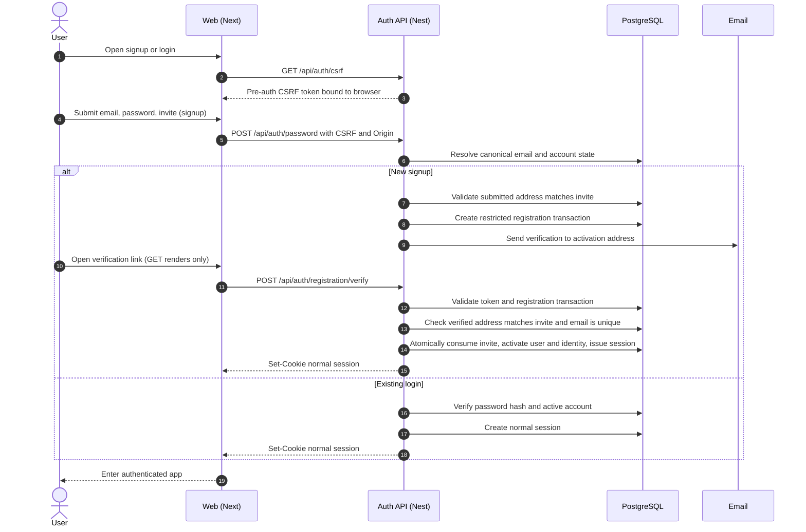
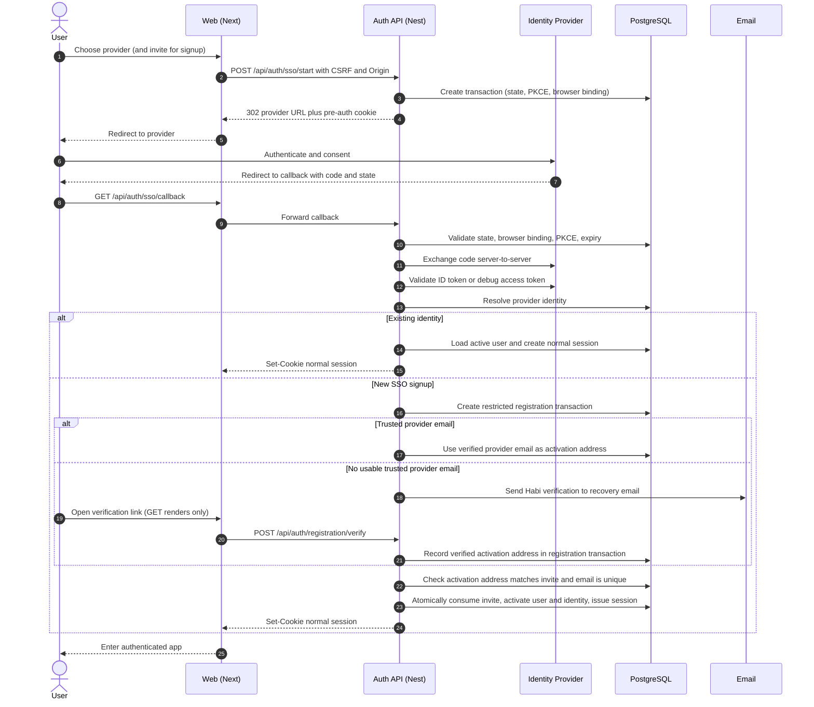
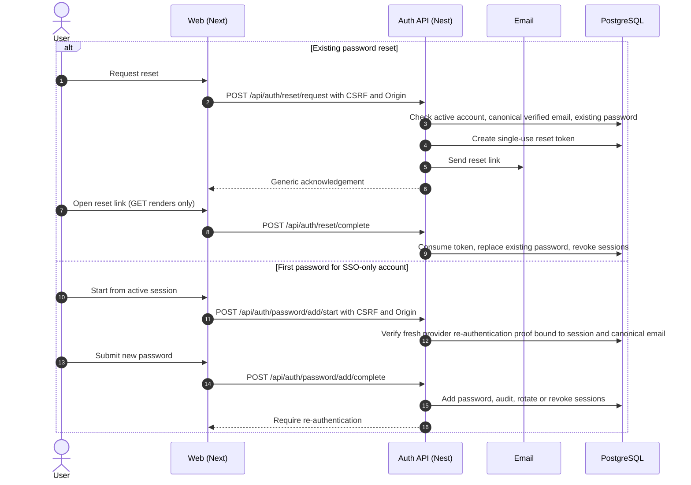

# Auth Architecture and SSO Design — H-008

- **Status:** **Owner accepted the H-008 planning design locally on 2026-10-23; this revision is prepared for user-authorized publication on 2026-10-28**, including the documented AI-review limitations and deferred prerequisites. The document is **not merged**. Remote H-008 acceptance is **pending after publication**: issue #8 is OPEN and depends on H-002, whose remote acceptance is also unrecorded despite the issue being CLOSED. Issue/board reconciliation belongs to the owner/parent. This is not implementation, runtime security proof, independent human certification, or a passed P0 gate.
- **Date:** 2026-10-23
- **Phase:** P0 — Feasibility (H-008)
- **Scope:** Select the auth architecture and specify sessions, CSRF, SSO callback binding, invite-only registration, account linking, missing-email recovery, provider scopes/setup, secret boundaries, and downstream contracts.
- **Authority:** [issue #8](https://github.com/daryllmagsombol/habi-bot/issues/8), the accepted [H-001 boundary](2026-10-21-poc-boundary-and-journeys-design.md), the owner-approved [H-002 object model](2026-10-22-object-and-context-model-design.md) (local revision), and the [H-008 research dossier](../research/2026-10-23-auth-architecture-decision-dossier.md).
- **Repository state:** runnable foundation only. Local manifests pin Next.js 16.4.2, NestJS 12.2.0, and Node 24.20.0. No auth, session, cookie, OAuth, or persistence code exists (`apps/web/package.json`, `apps/backend/package.json`, `.node-version`, `AGENTS.md`).
- **Baseline note:** H-002 is approved locally and is being prepared for publication alongside this document. Its remote acceptance record and closure reconciliation are still unrecorded: issue #2 is CLOSED without published acceptance evidence. This design relies on the local approved model, not on the merged draft or the issue's current GitHub state.
- **Review note:** this revision incorporates read-only builder findings and owner answers dated 2026-10-23. It has not been independently re-reviewed and makes no runtime claim.

This document separates **Owner decision** (recorded), **Design requirement** (accepted at planning fidelity), and **Deferred** (downstream implementation). Cryptographic defaults remain engineering recommendations, not individually selected owner values.

## 1. Outcome

Habi will use **Nest-owned authentication**: the Nest API starts and completes provider callbacks, exchanges codes, issues sessions, validates sessions, and enforces resource authorization. The Next web app renders auth surfaces and reaches the API through a **same browser-origin `/api` reverse-proxy target**. No domain, proxy product, vendor, deployment, or production provider registration is assumed by this design.

The design covers email/password and Google/Microsoft/Facebook SSO under **invite-only** registration. Every new account, including a new SSO account, requires a valid invite whose intended email matches the verified activation address. Accounts are anchored to provider-specific identity keys, never to email. Every active account has exactly one unique verified canonical login/recovery email. Missing or unusable verified email requires a Habi-verified recovery email before activation. Linking requires fresh proof of the existing Habi account plus proof of the new provider identity. No path silently merges accounts or silently creates a password.

## 2. Owner decisions — 2026-10-23

| Decision | Recorded choice | Boundary |
|---|---|---|
| D1. Architecture | Nest-owned auth; Nest issues and validates sessions | Not a claim that Next is insecure; alternatives are recorded in §3.4 |
| D2. Deployment target | Same browser-origin reverse proxy with `/api` routed to Nest | A target design, not a deployed domain, proxy, or vendor |
| D3. Registration | Invite-only for **both** email/password signup and new SSO signup | Existing users can sign in without a new invite; numeric invite policy deferred |
| D4. Missing email | When no usable verified email is available, a Habi-verified reachable recovery email is required before activation | Never infer an address; never auto-merge by email |
| D5. Linking | Fresh proof of the existing Habi account plus proof of the new provider identity | Provider-only login is insufficient; collisions do not merge |
| D6. Unlink | Block removal of the last working auth method | Add a password or another provider first |
| D7. Issue ownership | #8 human identity/session design; #21 inference connections; #17 session/secret lifecycle; #16 ownership | Exact storage implementation remains downstream |
| D8. Invite binding | An invite is **email-bound**: the verified activation address must match the intended invite | A mismatch denies activation; no fallback to a different address |
| D9. Canonical email | **One unique verified login/recovery email per active account** | Conservative canonical comparison; no provider-specific rewriting |
| D10. Password recovery | Email reset **only replaces an existing password**; a first password requires fresh existing-provider authentication and an explicit add | No reset path creates a password, and no support override exists |

D4–D10 are design constraints, not runtime evidence. Local planning acceptance is recorded; this revision is prepared for publication, while remote H-008 acceptance recording is pending after publication.

## 3. Architecture

### 3.1 Selected shape

- **Nest auth module** owns `/api/auth/*`, provider callbacks, code exchange, identity proof, registration transactions, invite redemption, session creation/validation, CSRF validation for auth and cookie-authenticated routes, linking, and logout.
- **Next web** owns rendering, navigation, and form submission. It does not mint sessions, validate sessions, or hold provider client secrets.
- **PostgreSQL** is the only database and the only session/token store. No Redis, NoSQL store, or second database is introduced (H-002 invariant 1).
- The browser sees one origin. `/api` is a reverse-proxy target to Nest; the auth cookie is first-party. No cookie `Domain` attribute is chosen here.

### 3.2 Why Nest-owned

Session issuance, session validation, and resource authorization stay in one runtime. That reduces the number of cross-runtime auth contracts and keeps revocation, CSRF, and owner checks in the component that already enforces H-002 predicates. This is a responsibility-locality choice, not a claim that a Next-owned design is inherently unsafe.

### 3.3 Component responsibilities

| Component | Owns | Must not own |
|---|---|---|
| Next web | Auth screens, redirects, form posts, accessible errors | Session issuance/validation, provider secrets, authorization decisions |
| Nest auth module (#8) | Auth endpoints, identity proof, registration transaction, invite redemption, sessions, CSRF, linking | Inference-provider credentials; resource ownership outside auth |
| Nest runtime (#17/#21 modules) | May host the auth module and provider adapters; #21 owns inference connections; #17 owns session/secret lifecycle mechanics | Auth module does not become the owner of #21/#17 credentials by sharing a process |
| PostgreSQL | Users, identities, invites, registration transactions, sessions, one-time tokens, audit records | Browser-readable state |
| Reverse proxy | Routes `/api` to Nest on the browser origin | Authentication decisions |
| Email sender | Verification, reset, and security notices | Authentication decisions |

The auth module is a logical module inside Nest, not the owner of the whole Nest runtime. Co-locating code does not merge issue ownership.

### 3.4 Rejected alternatives

| Alternative | Fair assessment | Why not selected |
|---|---|---|
| Next-owned sessions | Can be secure when the API validates the web-issued session at one boundary and still enforces resource ownership | Splits session issuance from the API that authorizes resources; adds a cross-runtime session contract and shared configuration |
| Split (web redirect, API exchange) | Preserves API secret ownership and can be secure | Adds an internal hop and handoff without a demonstrated POC constraint; revisit only if deployment or trust ownership forces it |

Neither rejected option is described as insecure. The selection is about where responsibility lives for this POC.

## 4. Flows

### 4.1 Email/password signup and login



Password signup always uses Habi email verification. A pre-activation registration transaction is not a normal session and does not authorize an active user. It may hold verification proofs: the verified activation address, the pending provider identity (if any), and the invite reference. Activation creates the H-002 `active` user and identity only at the atomic commit. No `pending` User status is introduced.

### 4.2 SSO login or new SSO signup



The callback is accepted only when the transaction is bound to the initiating browser independently of values the callback carries. An attacker who obtains a valid `state` cannot complete the flow in another browser. A provider email is used as the activation address only when its trust predicate is explicitly satisfied (§7.1); otherwise Habi verifies the recovery email.

### 4.3 Link a provider to an existing account

```mermaid
sequenceDiagram
    autonumber
    actor U as User
    participant W as Web (Next)
    participant A as Auth API (Nest)
    participant I as Identity Provider
    participant D as PostgreSQL
    U->>W: Start link from an active session
    W->>A: POST /api/auth/link/start with CSRF and Origin
    A->>D: Revalidate active session and fresh existing-account proof
    A->>D: Create link transaction (user, session, proof, provider, browser binding)
    A-->>W: 302 provider URL
    W-->>U: Redirect to provider
    U->>I: Authenticate and consent
    I-->>U: Callback with code and state
    U->>W: GET /api/auth/link/callback
    W->>A: Forward callback
    A->>D: Validate state, browser binding, same active session, unexpired proof
    A->>I: Exchange code and validate identity
    A->>D: Revalidate account and session; reject if identity is linked elsewhere
    A->>D: Commit identity link atomically and write audit record
    A-->>W: Success (no new account)
```

The callback must belong to the **same active user and session** that started the link. Fresh proof of the existing account means re-authentication with the current password or an already-linked provider. A fresh login at the new provider proves only the new identity, not ownership of the Habi account. Logout, password reset, session revocation, or account disable invalidates outstanding link transactions; a post-logout callback cannot complete a link. The provider-identity unique constraint is enforced at commit.

### 4.4 Password reset and first password



Reset is available only when the account already has a password and a canonical verified email. The reset link is a GET that renders a form; the token is consumed only by the POST. A first password is never created by reset: an SSO-only account must authenticate freshly with an existing provider and explicitly add a password. No support override exists.

### 4.5 Invite redemption and activation

Invite redemption is **server-enforced, email-bound, atomic, and single-use** for both email/password and new SSO signup.

1. Validate that the invite's intended email equals the verified activation address; a mismatch denies activation.
2. Validate the invite before creating the registration transaction; do not consume it on a failed identity or email-verification step.
3. Consume the invite in the same database transaction that activates the user and identity, using a row lock or equivalent unique constraint so concurrent attempts yield at most one account.
4. If activation loses the race, roll back the registration transaction and do not issue a session.
5. Existing users signing in do not consume an invite.

Invite issuance, expiry, seat counts, and reissue policy are **Deferred**. No numeric invite policy is invented here.

## 5. Transaction binding and callback security

### 5.1 Binding requirements

- `state` is random, single-use, server-stored, and expiring.
- The transaction binds to the **initiating browser** independently of callback parameters: a pre-auth browser cookie or equivalent server-recognized browser handle, plus the provider, action (login/link), and redirect URI.
- A callback-carried one-time handle, echoed `state`, or provider `Origin` alone is **not** proof that the receiving browser initiated the flow.
- On success, consume the transaction, rotate the session, and discard the pre-auth state.
- On failure, do not create a session or link; reject ambiguous binding.

### 5.2 Registration transaction

The pre-activation state is a **restricted, expiring registration transaction**, not a normal session, not an authorized user, and not an H-002 `active` account. It may hold only the minimum proofs needed for activation:

- verified activation address and verification method;
- provider identity and provider-email trust result (new SSO account);
- invite reference and intended email;
- expiry, attempt counter, and audit correlation.

For password signup, the restricted transaction may also retain the password verifier needed for activation, never the plaintext password. Bind the registration transaction to its initiating browser and original credential/provider proof; email verification alone must not transfer or replace that proof. Expiry or cancellation removes the temporary material.

It cannot call product APIs, authorize data access, or be used as a login session. Activation atomically consumes the invite, creates the H-002 user and identity, and issues a normal session; a conflict rolls the whole transaction back. This avoids introducing a `pending` User status that H-002 does not define.

### 5.3 Callback GET preferred; form_post fails closed

Prefer providers that return the authorization response by **GET** redirect with `SameSite=Lax` or `Strict` as appropriate. A `response_mode=form_post` callback is a cross-site POST and does not carry a `SameSite=Lax` cookie. It requires a separately reviewed browser binding that independently identifies the initiating browser; no specific form_post mechanism is selected or approved here.

If a provider or browser cannot support a binding that independently identifies the initiating browser, the callback **fails closed**. This design does not approve a form_post exception by assertion.

### 5.4 GET exception and form submissions

The OAuth/SSO callback GET is a **narrow protocol exception** to the no-state-changing-GET rule. It validates the transaction; only after the independent browser binding succeeds may it consume the transaction and create a session or link.

All other state-changing operations use POST. Reset and verification links are GET requests that render a form only; the token is consumed by a subsequent POST, so mail scanners and link previewers cannot activate or reset an account. Password login, signup, reset, verification, password-add, password-change, email-change, and link-start POSTs use §6.4 protections and non-enumerating responses.

### 5.5 Provider protocol controls

- Use the authorization-code flow; never the implicit flow for login.
- Use PKCE `S256` where supported or required. `plain` is **not approved**; a provider that cannot use `S256` is a blocker for that provider pending separate review.
- Validate `redirect_uri` against an exact allow-list before code exchange.
- For OIDC, validate signature, exact `iss`, `aud` containing the client ID, `nonce`, and expiry.
- For Facebook, exchange the code server-side and validate the access token through the debugging endpoint, including `app_id` and `user_id`.
- Reject replayed or expired codes/states.

### 5.6 Open redirect and provider mix-up

Only relative, server-validated return paths are allowed. External return URLs are rejected. Each provider has its own callback configuration and issuer/audience checks; a generic callback does not accept an arbitrary issuer.

## 6. Session model

### 6.1 Server record

A session is a server-side record tied to one active user, with creation time, last-seen time, idle expiry, absolute expiry, revocation state, authentication method, and a coarse device descriptor. The browser holds only an opaque random secret. The database is the source of truth.

**Engineering recommendation:** use a CSPRNG with at least 128 bits of entropy for the session secret. Storing a one-way verifier instead of the raw secret is an optional hardening measure, not a baseline requirement. Exact entropy, hash choice, and cookie name are implementation decisions.

### 6.2 Cookie

| Attribute | Design requirement |
|---|---|
| `HttpOnly` | Required; never readable by JavaScript |
| `Secure` | Required outside local development |
| `SameSite` | `Lax` for eligible top-level GET auth flows; `Strict` only where compatible; POST callbacks need §5.3 |
| `Path` | `/` |
| `Domain` | Omitted by default (host-only) |
| Lifetime | Bounded by server-side idle and absolute expiry; no persistent forever-cookie |

A `Strict` pre-auth cookie would not be sent on a cross-site provider redirect; it is not a substitute for a supported GET flow. Numeric lifetimes are unselected and must be set and verified before exposure.

### 6.3 Rotation, revocation, and logout

- Rotate the session identifier on login, privilege change, link/unlink, password add/change, and email change.
- Destroy the pre-auth state and registration transaction on successful authentication or activation.
- Logout invalidates the server record; cookie deletion alone is insufficient.
- Logout-all invalidates every session for the user.
- Revoke on password reset, account disable/delete, provider unlink, email change, and suspicious activity.
- Logout, reset, revocation, or account disable invalidates outstanding link and registration transactions.
- Account deletion revokes sessions and provider links; H-002 §16.1 requires the external/derived store map to be honored.

### 6.4 CSRF

Cookie-authenticated state-changing routes require a synchronizer token bound to the session, plus Origin/Referer validation. SameSite is defense-in-depth, not the only control. The same synchronizer-token pattern is used for pre-auth password login/signup and for reset, verification, password-add, password-change, email-change, and link-start forms, with a pre-auth browser binding. Double-submit cookies are not used. Login and link callbacks use the transaction binding in §5, not only a CSRF token. Responses do not reveal whether an account, invite, or email exists.

### 6.5 Validation by API and worker

The API validates the session cookie on every browser request and resolves the active user before resource authorization. Workers do **not** receive browser cookies or share session state; they consume run/job context and revalidate ownership. #17 defines the exact worker contract.

## 7. Account lifecycle

### 7.1 Identity and email trust

| Provider | Identity key | Provider email trust predicate |
|---|---|---|
| Google | `(issuer, subject)` from the validated ID token | Require `email_verified` and a reviewed predicate establishing Google's authority over the address; that flag alone is insufficient for arbitrary third-party email domains. Otherwise require Habi verification |
| Microsoft | `(issuer, subject)` from the validated ID token | Do **not** assume the `email` claim is verified; require Habi verification unless a reviewed predicate proves otherwise |
| Facebook | App-scoped user ID from a validated token | Do **not** assume email presence or verification; require Habi verification |

A provider email may count as verified only through an explicit per-provider trust predicate backed by the provider's documented claim. There is no generic “provider email is verified” rule. If the predicate is not satisfied, Habi verifies the address. Provider-email trust never replaces the provider-subject identity key. A later provider-email change does not silently change the canonical email; §7.6 applies.

### 7.2 Canonical email and uniqueness

Every active account has exactly one canonical verified login/recovery email.

- Trim surrounding whitespace and normalize the domain consistently using validated IDNA handling and lowercase comparison; do not Unicode-normalize or otherwise rewrite the local part.
- Preserve the local part exactly: no Gmail dot/plus stripping, no arbitrary local-part rewriting, and no provider-specific alias rules.
- Compare the canonical string conservatively; a unique constraint on the active canonical email prevents two active accounts from sharing one address.
- Validate uniqueness atomically at activation and at email change.

Password signup always uses Habi verification. SSO may rely on a trusted provider claim under §7.1, otherwise Habi verification is required. No account is activated with an unverified canonical email.

### 7.3 Invite-only registration and email binding

Public registration is off. Email/password signup and new SSO signup both require a valid invite. The invite stores the intended email; the verified activation address must match it exactly under §7.2 normalization. A mismatch denies activation and does not fall back to a different address.

The invite gate is enforced server-side before activation; a UI-only gate is insufficient. Existing users sign in without an invite. An invite for an address already used by an active account cannot create a second account; the user must authenticate the existing account instead. Numeric invite policy is deferred.

### 7.4 Missing or unusable email

If the provider email is missing, unverified, or not trusted, the user must supply a reachable recovery email and complete Habi verification before activation. The address must match the invite. The account identity remains the provider subject. The recovery email is not used to auto-merge with an existing account.

### 7.5 Linking, collisions, and unlink

- Linking requires an active Habi session, fresh proof of the existing account, and proof of the new provider identity; the callback must be the same active session.
- If the provider identity is already linked elsewhere, deny with a non-enumerating response; do not merge.
- If the canonical email matches an existing account but the provider subject is new, do not auto-link; require authentication to the existing account, then link.
- A collision must authenticate the existing account; no email-based merge path exists.
- Unlink is blocked when it would remove the last working auth method. Add a password or another provider first.
- Unlink revokes or requires re-authentication for affected sessions.

### 7.6 Password reset, first password, and email change

- **Existing password reset:** allowed only when the account has an existing password and a canonical verified email. The request resolves only the unique active canonical email. It replaces that password; it never creates one. The reset token is single-use, consumed by POST, and revokes sessions.
- **First password:** an SSO-only account must authenticate freshly with an existing provider, then explicitly add a password from the active session. No reset link can create it.
- **Verified Habi email:** the canonical login/recovery email verified by Habi or by an explicitly trusted provider claim under §7.1. Every active account must have one; newly activated accounts cannot remain email-less.
- **Lost email:** there is no support override. Use a remaining login method and the secure change-email procedure: fresh existing-account proof, a new address, Habi verification, and uniqueness check.
- **Email change:** requires an active session with fresh proof, verifies the new address, checks uniqueness, and revokes or rotates affected sessions according to #17.

## 8. Providers: scopes and setup

| Provider | Minimal identity scopes | Explicitly excluded |
|---|---|---|
| Google | `openid email` (`profile` optional) | Mail, calendar, drive, `offline_access` |
| Microsoft | `openid email` (`profile` optional) | Mail, calendar, files, `offline_access` |
| Facebook | `email` (public profile is baseline) | Friends, posts, pages, messaging, ads |

**Documented setup versus Habi readiness**

| Provider | Documented setup requirement | Habi readiness |
|---|---|---|
| Google | Cloud project, OAuth client, exact authorized redirect URI, consent screen | Unverified: no project/client recorded |
| Microsoft | App registration, redirect URI configuration, OIDC scopes | Unverified: no registration recorded; current console steps not rechecked |
| Facebook | App with Facebook Login, Valid OAuth Redirect URIs and Strict Mode, `state`, HTTPS data deletion callback, privacy-policy deletion instructions | Unverified: no app recorded; `email` App Review/Business Verification applicability is **unknown** |
| All | Production/staging hostname, TLS, reverse proxy, per-environment secrets, email sender and DNS authentication | Unverified; domain/deployment is not assumed |

Facebook's official pages fetched for this research do not state that email presence is guaranteed or that `email` specifically requires App Review/Business Verification. The design treats both as unknown, not as “not required.” Provider setup is not accepted for exposure until each registration and review status is verified.

## 9. Secrets and BYO boundary

| Concern | #8 auth module | #21 inference connections | #17 lifecycle | #16 ownership |
|---|---|---|---|---|
| Credential | Habi OIDC client secret; short-lived provider token for verification | User-supplied inference API key or per-user sign-in token | Storage, rotation, redaction | Owner predicates |
| Session | Issues and validates | Consumes identity only | Rotation/revocation mechanics | Cross-user denial |
| Scope | `openid email` only | Provider-specific inference scope | Secret lifecycle | Tenant isolation |

- Provider client secrets are server-side only, per environment, never in the browser bundle, logs, repository, or ordinary chat.
- Short-lived provider tokens used for identity verification are processed server-side and not persisted beyond verification unless a later reviewed flow requires it.
- No `offline_access` or refresh token is requested for identity-only SSO.
- #8 does not own inference-provider credentials. #21 owns inference connection behavior and revocation; #17 owns the shared secret-storage/rotation mechanics; #16 owns cross-user enforcement.
- The auth module may run in the same Nest process as #17/#21 code without acquiring ownership of their secrets. Exact storage table/API remains downstream; this document does not define it.

## 10. Threats and abuse controls

| Threat | Primary control | Residual owner |
|---|---|---|
| CSRF on state-changing routes | Synchronizer token, Origin/Referer, SameSite | #17 route coverage |
| Login CSRF | Browser-bound transaction, new session after auth | Auth tests |
| Session fixation | Destroy pre-auth state; rotate on auth/privilege change | Auth tests |
| Session theft | HttpOnly/Secure, TLS, no browser token storage, redaction | Frontend/CSP review |
| Open redirect | Relative allow-list; exact registered redirect URIs | Callback tests |
| Provider mix-up | Per-provider config, exact `iss`/`aud`, no generic issuer | Multi-provider tests |
| Code/state replay | Single-use, expiring state/code; reject replay | Integration tests |
| Token substitution (Facebook) | Debug endpoint, `app_id`/`user_id` check | Provider tests |
| Account takeover via linking | No email auto-merge; existing-account proof plus provider proof | Linking tests |
| Account takeover via reset | Reset only replaces an existing password; first password requires fresh provider proof | Auth tests |
| Invite/email mismatch | Email-bound invite checked at atomic activation | Concurrency tests |
| Canonical-email collision | Unique canonical email; no merge; authenticate existing account | Auth tests |
| Account enumeration | Generic errors, uniform responses where practical | Abuse tests |
| Invite race/double use | Atomic single-use redemption in the activation transaction | Concurrency tests |
| Unlink lockout | Block last-method removal; require replacement method | Recovery tests |
| Mail scanner activation | GET links render only; token consumed by POST | Integration tests |

### 10.1 Per-surface abuse limits

All numeric thresholds are **unselected** and must be set and verified before exposure. Limits must not create a permanent denial of service for a victim account from unauthenticated attempts.

| Surface | Key | Enforcement point | Owner | Numeric |
|---|---|---|---|---|
| Invite validation/redemption | Invite token, client IP, canonical email | Auth module, before transaction creation and at activation | #8/#17 | Deferred |
| Password signup | Client IP, canonical email | Auth module | #8/#17/#23 | Deferred |
| Password login | Client IP, account, canonical email | Auth module | #8/#17/#23 | Deferred |
| Reset request | Client IP, canonical email, account | Auth module | #17/#23 | Deferred |
| Reset, verification, password, email POST | Token/CSRF, client IP | Auth module | #17 | Deferred |
| SSO start | Client IP, provider, browser handle | Auth module | #8/#17 | Deferred |
| SSO callback | State/transaction, client IP, provider subject | Auth module | #8 | Deferred |
| Link start/callback | User, session, provider subject | Auth module | #8/#16 | Deferred |
| Session validation | Session, user | API | #17 | Deferred |

Client IP is derived only from a configured trusted-proxy chain; arbitrary `X-Forwarded-For` input is ignored. Account and invite keys are separate from IP so one attacker cannot trivially lock every account. Throttles are temporary and expiring; a victim can recover through an existing login method. No numeric value is approved here.

## 11. Downstream contracts

| Issue | Contract provided by this design |
|---|---|
| #14/#15 | Auth screens, invite gate, email-bound activation, SSO start/callback, generic errors, reset/recovery UX boundaries |
| #16 | Session-to-user anchor; owner checks remain authoritative on every resource |
| #17 | Session/secret lifecycle requirements: cookie attributes, rotation, revocation, logout-all, CSRF, provider-key storage/redaction, link/registration invalidation |
| #21 | Inference connections are separate; #8 supplies identity only, never inference keys |
| #23 | Abuse-limit surfaces exist; numeric values still to be chosen |
| #25 | Testable design acceptance points for auth, linking, invite, recovery, and CSRF; runtime tests remain downstream |

## 12. Design acceptance matrix

**Owner accepted this design locally on 2026-10-23. No criterion is runtime-verified and no P0 gate passes. Design acceptance does not require downstream implementation evidence.**

| #8 design criterion | Design evidence | Design status |
|---|---|---|
| One architecture selected with rationale and rejected alternatives | §3 (Nest-owned; Next-owned/split recorded) | Owner accepted at planning fidelity |
| Session, CSRF, rotation, revocation specified and testable | §5–§6 | Specified at design fidelity |
| Google/Microsoft/Facebook setup prerequisites and minimal scopes | §8 | Setup documented; Habi readiness unverified and not accepted for exposure |
| Missing-email handling and linking explicit; no silent merge | §4, §7 | Specified; email-bound invite and canonical email included |
| Registration mode recorded, not accidental | §2 D3/D8, §4.5, §7.3 | Invite-only and email-bound |
| Provider secrets server-side only | §9 | Specified at design fidelity |
| No mailbox/calendar/file access | §8 | Specified by scope list |
| Password reset and first-password boundaries explicit | §4.4, §7.6 | Specified |
| Per-surface abuse limits identified | §10.1 | Surfaces/keys/owners specified; numeric values deferred |

**Design acceptance status:** owner accepted all design criteria locally, with the documented review limitations and deferred prerequisites. Runtime evidence for sessions, CSRF, linking, invites, and provider behavior belongs to #14/#15/#17/#25. This revision is prepared for publication; remote acceptance evidence and issue closure are pending after publication. This approval does not authorize implementation.

### 12.1 Read-only builder review disposition

Corrections incorporated on 2026-10-23:

- Password signup and new SSO signup use a restricted registration transaction; no normal session or authorized user exists before activation.
- Pre-auth password/signup forms use a browser-bound synchronizer token plus Origin/Referer.
- Reset replaces an existing password only; a first password requires fresh provider authentication and an explicit add.
- The OAuth callback GET is a narrow exception; reset and verification links render only and consume tokens on POST.
- Invites are email-bound; active accounts have one unique verified canonical email; collisions require authenticating the existing account.
- Link callbacks must remain on the same active session/user and are invalidated by logout, reset, or revocation.
- The component table separates the #8 auth module from the whole Nest runtime and from #17/#21 secret ownership.
- Per-surface abuse limits have explicit keys, enforcement points, and owners; numeric values remain deferred.
- The acceptance matrix treats runtime evidence as downstream, not as a condition of the design gate.

The builder review was read-only. This draft has not been independently re-reviewed and makes no runtime or security-certification claim.

## 13. Deferred inputs and prerequisites

**Deferred implementation inputs**

- Auth library or hand-rolled OIDC client; exact password-hash parameters.
- Session idle/absolute lifetimes, concurrency limits, abuse thresholds, token TTLs.
- Invite issuance/expiry/reissue policy.
- Email provider, sender domain, SPF/DKIM/DMARC.
- Secret manager/rotation procedure and audit schema.
- Provider tenant/account-type configuration and production registrations.

**Prerequisites, not design questions**

1. Numeric session/abuse values must be selected and verified before exposure; #17/#23 own the values.
2. Production domain, TLS, and proxy are required before runtime; the design target does not assume them.
3. Facebook `email` App Review/Business Verification applicability is unknown; it affects enablement, not the architecture.

No unresolved material owner question remains for this design. Local planning acceptance is recorded; this revision is prepared for publication, and remote issue reconciliation is pending after publication.

## 14. Sources

| Source | Use |
|---|---|
| [Issue #8](https://github.com/daryllmagsombol/habi-bot/issues/8) | Outcome, checklist, acceptance, non-goals |
| [H-001 boundary](2026-10-21-poc-boundary-and-journeys-design.md) | Identity-only SSO, missing email, no silent merge, open decisions 2/7 |
| [H-002 object model](2026-10-22-object-and-context-model-design.md) (local approved) | Owner chain, non-enumerating denial, session revocation, one database |
| [H-008 dossier](../research/2026-10-23-auth-architecture-decision-dossier.md) | Prior option analysis and provider research |
| [Issue #16](https://github.com/daryllmagsombol/habi-bot/issues/16), [#17](https://github.com/daryllmagsombol/habi-bot/issues/17), [#21](https://github.com/daryllmagsombol/habi-bot/issues/21) | Ownership, lifecycle, and BYO boundaries |
| [Google OpenID Connect](https://developers.google.com/identity/openid-connect/openid-connect) | Scopes, email claims, redirect URI match |
| [Microsoft OIDC scopes](https://learn.microsoft.com/en-us/entra/identity-platform/scopes-oidc) | Scopes and conditional email claim |
| [Meta permissions](https://developers.facebook.com/documentation/development/permissions), [login security](https://developers.facebook.com/documentation/facebook-login/security), [data deletion](https://developers.facebook.com/documentation/development/create-an-app/app-dashboard/data-deletion-callback) | Email permission, state/redirect/token controls, deletion callback |
| [RFC 7636](https://www.rfc-editor.org/rfc/rfc7636) | PKCE `S256` |
| [OpenID Connect Core](https://openid.net/specs/openid-connect-core-1_0.html) | `iss`/`aud`/signature/nonce/state validation |
| [OWASP Session Management](https://cheatsheetseries.owasp.org/cheatsheets/Session_Management_Cheat_Sheet.html), [CSRF Prevention](https://cheatsheetseries.owasp.org/cheatsheets/Cross-Site_Request_Forgery_Prevention_Cheat_Sheet.html) | Engineering guidance; not a substitute for the owner decisions above |

**Planning design accepted locally; prepared for publication. Not merged. No implementation or runtime proof; P0 has not passed.**
