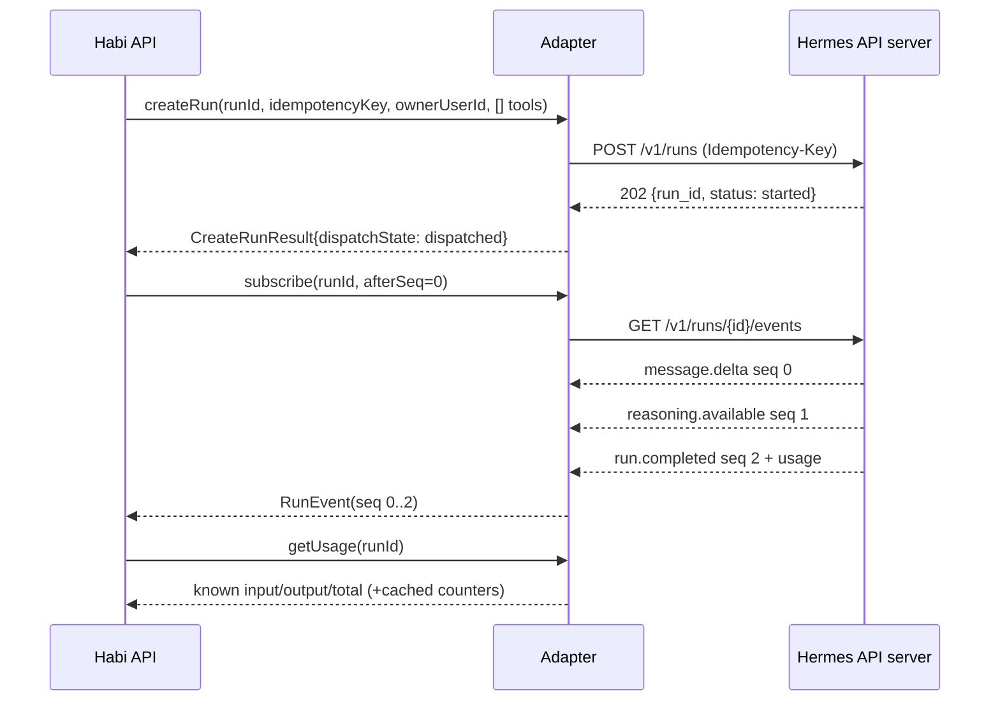
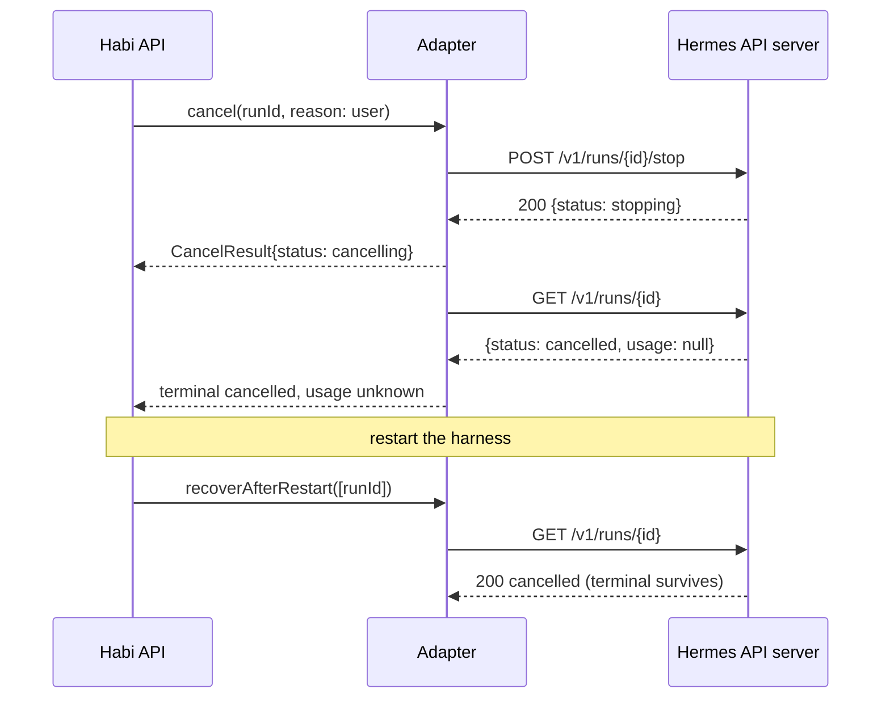
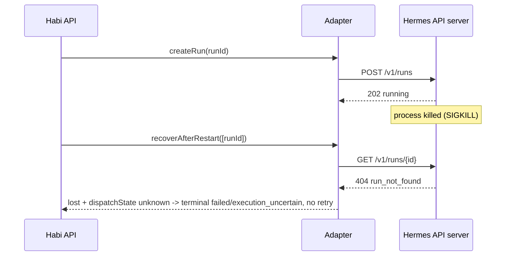

# Hermes adapter contract — design (H-004 interface draft)

- **Status:** **Interface draft; H-004 remains open.** The owner pinned `NousResearch/hermes-agent` v0.22.2 at `d923a5eb487a17c0a68801bba9ef0f56c81040a8` with the local API-server interface on 2026-11-03. A bounded spike then observed create (202), idempotent replay of one run, ordered events with a terminal last event, terminal failure, steer acceptance while running, `stopping → cancelled`, usage fields, and terminal-state visibility after a harness restart. Steering's effect on output, in-flight restart recovery, and cancellation billing remain unproven. See [the lifecycle evidence](../research/2026-11-03-h004-hermes-spike-attempt.md).
- **Date:** 2026-11-03. **Phase:** P0 — Feasibility, planning fidelity only.
- **Scope:** A contract Habi can implement and later satisfy with a direct-call implementation instead of Hermes. No product code, schema, dependency, credential, install, or runtime change accompanies it.
- **Authority:** the H-004 issue body (read-only), the accepted [single-user CommandCode scope](../research/2026-11-03-h003-commandcode-scope-acceptance.md), the accepted [H-002 object model](./2026-10-22-object-and-context-model-design.md), and the observed [pinned Hermes behaviour](../research/2026-10-28-personal-commandcode-hermes.md). Route, status, idempotency, and usage names in §3 are read from pinned source; none were executed.

## 1. Non-claims and relation to accepted work

| Reference | Relation to this contract |
|---|---|
| [H-001 boundary](./2026-10-21-poc-boundary-and-journeys-design.md) | No-tool, no-shell, no-browser, no-sharing boundary inherited unchanged. `allowedTools` is empty in the POC; the adapter cannot add capability. |
| [H-003 scope acceptance](../research/2026-11-03-h003-commandcode-scope-acceptance.md) | Supplies one provider path for a **single user** (the owner). It does not authorize multi-user dispatch and does not pin a harness version. |
| [H-002 object model](./2026-10-22-object-and-context-model-design.md) | Habi's Run, RunEvent, Message, usage status, lease fencing, and `(run_id, seq)` envelope are normative. This contract adapts to them; it does not redefine them. |
| [H-008 auth design](./2026-10-23-auth-architecture-and-sso-design.md) | `ownerUserId` is resolved server-side from a validated session. The adapter never derives identity from harness output, headers, or prompt text. |
| [Allowance design](./2026-10-28-provider-access-and-daily-allowance-design.md) | Budget and allowance semantics stay in Habi (§7–§9 there). The adapter reports usage; it does not decide allowance. |

Route names below are static source facts, not runtime evidence: response bodies, streaming behaviour, and error shapes remain unverified for H-004.

## 2. Interface (TypeScript-shaped, not implemented)

Every method is called **after** Habi has authorized the operation and atomically reserved budget. The adapter re-checks that `ownerUserId` equals the persisted Run owner and fails closed otherwise.

```ts
type Id<T> = string & { readonly __brand: T }; interface ChatMessage { role: "user" | "assistant" | "system"; content: string; messageId: Id<"Message">; }

interface CreateRunRequest {
  runId: Id<"Run">; idempotencyKey: string; correlationId: string;  // key unique per (ownerUserId, idempotencyKey)
  ownerUserId: Id<"User">; conversationId: Id<"Conversation">; botId: Id<"Bot">;
  messages: readonly ChatMessage[];           // Habi-selected context; adapter must not re-select memory
  deadlineAt: string;                         // ISO-8601 UTC; Habi-enforced, adapter best-effort
  tokenBudget: { maxInputTokens: number; maxOutputTokens: number | null };
  allowedTools: readonly string[]; }          // MUST be [] in the POC; non-empty is rejected
type DispatchState = "not_dispatched" | "dispatched" | "unknown";
type HarnessRunStatus = "queued" | "running" | "waiting_for_approval" | "stopping" | "cancelled" | "failed" | "completed";
interface CreateRunResult { runId: Id<"Run">; harnessSessionId: string | null; harnessRunId: string | null;
  dispatchState: DispatchState; deduplicated: boolean; acceptedAt: string; }  // deduplicated = same run, no re-dispatch

interface SubscribeRequest { runId: Id<"Run">; afterSeq: number; signal?: AbortSignal; }
type SubscribeResult = AsyncIterable<RunEvent>;                               // at-least-once; see §5
interface CancelRequest { runId: Id<"Run">; reason: "user" | "deadline" | "shutdown" | "policy"; }
interface CancelResult { runId: Id<"Run">; status: TerminalStatus | "cancelling"; dispatchState: DispatchState; }
interface SteerRequest { runId: Id<"Run">; text: string; clientSteerId: string; }
interface SteerResult { accepted: boolean; reason?: "already_terminal" | "not_running" | "rejected_by_harness"; }

interface RunSnapshot { runId: Id<"Run">; status: "queued" | "running" | "completed" | "failed" | "cancelled" | "timed_out";
  harnessStatus: HarnessRunStatus | null; lastSeq: number; version: number; }
interface UsageRecord { runId: Id<"Run">; usageStatus: "known" | "partial" | "unknown"; grossPromptTokens: number | null; grossCompletionTokens: number | null; cachedPromptTokens: number | null; reasoningTokens: number | null; totalTokens: number | null; costStatus: "known" | "unknown"; raw: Record<string, unknown>; }

interface Adapter {
  createRun(req: CreateRunRequest): Promise<CreateRunResult>;
  subscribe(req: SubscribeRequest): SubscribeResult;
  cancel(req: CancelRequest): Promise<CancelResult>;
  steer(req: SteerRequest): Promise<SteerResult>;
  getRun(runId: Id<"Run">): Promise<RunSnapshot>;
  getUsage(runId: Id<"Run">): Promise<UsageRecord>;
  recoverAfterRestart(input: { runIds: readonly Id<"Run">[] }): Promise<RecoveryReport>;
  close(): Promise<void>;                     // releases transport; must not silently terminate live runs
}
```

`recoverAfterRestart` returns, per Run, exactly one of `confirmed_terminal(snapshot)`, `still_running(snapshot, resumeAfterSeq)`, or `lost` (§6.4). The adapter is stateless with respect to authorization and budget.

## 3. Concrete harness surface (pinned source, not executed)

Adapter binding to the API-server route table. Every route is authenticated by the harness in addition to Habi's own checks; the harness credential is never a Habi session.

| Adapter method | Route / fact | Notes |
|---|---|---|
| `createRun` | `POST /v1/runs` | **202 at creation observed on the pinned harness**; a duplicate `Idempotency-Key` replayed the same `run_id` with `Idempotency-Replayed: true`. |
| `getRun` | `GET /v1/runs/{run_id}` | Carries run status and usage fields. |
| `subscribe` | `GET /v1/runs/{run_id}/events` | Replay and cursor semantics of this endpoint are unverified (§11). |
| `steer` | `POST /v1/runs/{run_id}/steer` | Text only; see §6.3. |
| `cancel` | `POST /v1/runs/{run_id}/stop` | Harness reports `stopping`, then `cancelled`. |
| `getUsage` | Usage on the run-status/event payload | No separate usage route in the pinned table; exact carrier and per-shape fields unverified. |

Recovery reuses `getRun` plus events replay; there is no dedicated recovery route. Also exposed: `POST /v1/runs/{run_id}/approval` (tool approval), `GET /v1/skills`, and OpenAI-compatible `POST /v1/chat/completions` plus `POST`/`GET`/`DELETE` `/v1/responses`. **None is part of this contract.** With `allowedTools` empty, tool approval is unreachable and any approval request is denied by Habi policy; the OpenAI-compatible routes must not be used to bypass run lifecycle, idempotency, or ownership mapping.

Harness statuses are `queued`, `running`, `waiting_for_approval`, `stopping`, `cancelled`, `failed`, `completed`. Habi maps them to its own states; `timed_out` and `execution_uncertain` are Habi-only outcomes. `waiting_for_approval` is a policy failure for a no-tool POC (no approval path exists), and `stopping` is non-terminal.

Idempotency is a durable SQLite store (`runs_idempotency.db`) keyed by `(scope, idempotency_key)` holding a fingerprint and `run_id`. `scope` is derived server-side from the harness profile and API-key namespace (SHA-256), so the same client key under a different profile or key is a **different** reservation. TTL/eviction, the request header name, and fingerprint-mismatch behaviour are unverified (§11).

## 4. Identifier mapping and authority

| Concern | Rule |
|---|---|
| `runId` | Habi-generated, owned, and the only identifier accepted by Habi APIs. |
| `harnessSessionId` / `harnessRunId` | Opaque harness identifiers persisted in an adapter-owned mapping row keyed by `runId`, written only by the adapter, never accepted from a client. Lookup is `runId → harness*` only; an unknown harness value presented to Habi is rejected, not trusted. At most one live harness run exists per `runId`; a second one is a defect to reconcile, not a run to adopt. |
| **Never authorization** | The harness ID is **never** an authentication or authorization token, never a session substitute, and never sufficient to read a transcript or steer/cancel a run. Habi re-checks owner, conversation, and Bot on every call. |

## 5. Event model

Reuses the H-002 envelope: `{ id, runId, ownerUserId, conversationId, seq, type, payload, createdAt }`, unique `(runId, seq)`, `seq` allocated server-side per run from 1.

| Type | Meaning | Notes |
|---|---|---|
| `run.created` | Run accepted and dispatch state recorded | At most once; carries `dispatchState`. |
| `message.delta` / `message.completed` | Incremental assistant text, then content finished | Deltas are coalescible; `message.completed` is not a terminal run state. |
| `usage.recorded` | Usage fields for the run | Precedes or commits with the terminal event (rule 4). |
| `run.completed` / `run.failed` / `run.cancelled` | Terminal states | Exactly one per run. |
| `policy.denied` | A capability request refused by Habi policy | Emitted by Habi; never implies partial success. |

1. **Ordering:** strictly increasing `seq` per run as delivered; `createdAt` is not an ordering key.
2. **At-least-once:** delivery may repeat; consumers dedupe by `(runId, seq)` before any UI or transcript effect. Payloads carry no secrets and no full prompts by default.
3. **Terminal stability:** the terminal event is immutable, is the last state-changing event, and is replayable after reconnect; no `message.delta` follows it, and late output is discarded.
4. **Cursor and usage:** Habi persists the highest applied `seq` per stream and resumes with `afterSeq`; a `seq` gap is an incomplete replay, not empty output. `usage.recorded` precedes or commits with the terminal event, and a late correction is a `getUsage` revision rather than a new event (retroactive writes conflict with H-002 §7).

## 6. Lifecycle semantics

**6.1 Create and idempotency.** Habi's `(ownerUserId, idempotencyKey)` record is the authoritative dedupe; the harness store is a second layer scoped to one profile/key namespace and cannot be relied on across key or profile changes. A duplicate returns the **same** `runId` with `deduplicated: true`, performing **no second dispatch** and no second reservation; the same key with a different body is an `idempotency_conflict` with no dispatch. A duplicate against a terminal Run returns that terminal Run unchanged. A non-empty `allowedTools`, a missing `deadlineAt`, or an owner mismatch rejects before dispatch.

**6.2 Cancel.** `cancel` is idempotent. Habi treats cancellation as terminal even while the provider call unwinds, and late deltas are discarded. The terminal `cancelled` state must be observable **after reconnect** through `getRun` and replay, not only on the live stream. "No further tokens are billed" is an **acceptance claim to verify** (§11), not a property assumed here; unreported usage is `unknown`, never zero.

**6.3 Steer.** Text only. Steering **cannot** add tools, widen data scope, change `botId`/`ownerUserId`/`conversationId`, raise `tokenBudget`, or extend `deadlineAt`; structural fields are rejected, not coerced. Steering after a terminal state returns `already_terminal` and changes nothing. Steering text is Habi-persisted user intent re-scoped to the existing run, never a capability grant. **Observed 2026-11-03:** the harness returned `200 accepted: true` but the run completed the original instruction unchanged and retained a `pending_steer` field; treat steering as acknowledged-but-unapplied, expose it as unsupported, and do not build UX on it.

**6.4 Restart recovery.** **Habi persistence is authoritative** for the transcript, message sequence, Run status, terminal outcome, and usage status; the adapter never owns user-visible history. On restart the adapter reconciles each non-terminal Run as confirmed terminal (adopt and finalize), still running (resume from `afterSeq`), or `lost`. `lost` with `dispatchState = unknown` yields terminal `failed` / `execution_uncertain` per H-002 with no automatic retry of potentially paid work. Reconciliation must not double-emit terminal events or mark a completed Run failed.

**6.5 Deadlines and timeouts.** Habi enforces `deadlineAt`; adapter handling is best-effort and may not bound provider execution. Expiry triggers `cancel(reason: "deadline")`, a bounded reconciliation window, then `unknown` usage if no terminal evidence exists. Because harness output caps are unproven (§10), the adapter must not claim that a token budget bounds one request's completion.

## 7. Errors, failure classification, and retry

The harness can return **HTTP 200** with `finish_reason: "error"` and `hermes.failed: true`, and `/v1/runs` can return **HTTP 202** at creation and later report the run `failed`. HTTP status alone is insufficient, and vendor error copy is unreliable.

| Normalized code | Trigger (observed shapes) | Dispatch | Auto-retry |
|---|---|---|---|
| `auth_rejected` / `invalid_request` | Pre-dispatch credential or validation rejection | `not_dispatched` | No (owner action for auth) |
| `policy_denied` | Habi refusal, including `waiting_for_approval` | `not_dispatched` | No |
| `transport_ambiguous` | Reset/timeout/EOF after request write | `unknown` | **No** |
| `provider_error` | HTTP 200 + error finish / `hermes.failed`; 202-then-`failed` | `dispatched` or `unknown` | **No** |
| `provider_rate_limited` / `provider_exhausted` | Mapped only from an explicit provider signal | as reported | **No** |
| `timeout` | Habi deadline exceeded | `dispatched` or `unknown` | **No** |
| `harness_unavailable` | Connect failure before request write | `not_dispatched` | Only if provably pre-write |

An error-in-success shape is a **failure**, never a success with empty text. Unknown cost is `unknown`, never `0`. Retry is permitted only when dispatch is proven `not_dispatched`; a user-initiated retry is a new Run with a new key.

## 8. Usage accounting

- Pinned usage keys are `input_tokens`, `output_tokens`, and `total_tokens`; the OpenAI-compatible chat route maps them to `prompt_tokens`, `completion_tokens`, and `total_tokens`. That key list exposes **no** cached or reasoning field, so those stay `null` unless a verified shape supplies them, and the record is then `partial`, not `known`.
- `grossPromptTokens` is the full billed prompt including any cached subset; `grossCompletionTokens` is the full completion including any reasoning subset. Raw reported fields are preserved verbatim in `raw` with the response-shape name; provider-specific field mapping is **deferred** (§11). Hermes' canonical sum reconciles Hermes counters and is not billing authority, so Habi applies the allowance design's definitions instead.
- `usageStatus` is `known` (complete, consistent), `partial` (defensible total, flagged), or `unknown` (missing, inconsistent, or ambiguous dispatch). `unknown` blocks further shared-key requests pending owner reconciliation and **must never render as zero**; `costStatus: "unknown"` is the default absent harness cost.

## 9. Authority boundary

| Habi owns (authoritative) | Hermes owns (in-flight only) | Must be reconstructed |
|---|---|---|
| Identity, session, authorization, ownership checks | The provider request in flight | Harness session/run identifiers (mapping row) |
| Conversation, messages, transcript, `seq`, memory selection | Streaming event production | Whether a dispatch occurred when the boundary is ambiguous |
| Budget, allowance reservation, admission, tool policy; empty tool set | Model/provider handling and declared advertised tools | Final assistant text after a crash (from Habi events/messages) |
| Terminal Run state, outcome, usage status | Nothing about budgets, allowance, or authorization | Usage totals the harness never reports; late provider errors |

## 10. Known harness behaviours that constrain this contract

Cited from the [personal CommandCode with pinned Hermes](../research/2026-10-28-personal-commandcode-hermes.md) note. The owner **pinned that commit** (`d923a5eb…`, v0.22.2) as the H-004 spike baseline on 2026-11-03; the behaviours below are source facts, not runtime results.

| Behaviour | Contract consequence |
|---|---|
| `api_max_retries: 3` default | `createRun` must be idempotent at both layers; client-visible retry is Habi's decision. Duplicate-dispatch risk must be measured. |
| `auto_recovery_cycles: 5` default | Recovery may continue without Habi's knowledge; `lost` is a valid reconciliation outcome and terminal state must not depend on harness cooperation. |
| Auxiliary routing can discover other providers | Credential isolation and empty fallbacks are prerequisites; one run does not imply one provider request. |
| No user-facing output cap survives; `max_tokens`/`HERMES_MAX_TOKENS` were not transmitted | `maxOutputTokens` is advisory only. No bounded completion budget may be claimed until proven. |
| ZDR header sent only on supported models; vendor enforcement unverified | Privacy is per-request, per-model, not an adapter guarantee. Non-ZDR models stay synthetic-only. |

## 11. Open questions and evidence still required

Rows 1, 2, 4, 8, 9, 11 have observations; rows 3 and 7 are partial; rows 5, 6, and 10 remain uncaptured. See [the lifecycle evidence](../research/2026-11-03-h004-hermes-spike-attempt.md).

| # | Open question | Required evidence (not yet captured) |
|---|---|---|
| 1 | Which Hermes commit/API interface is pinned for H-004? | **Answered:** v0.22.2 at `d923a5eb487a17c0a68801bba9ef0f56c81040a8`, local API server (`/v1/runs` surface), owner-pinned 2026-11-03 |
| 2 | Does `createRun` dispatch exactly once under a duplicate key? | **Observed:** duplicate `Idempotency-Key` returned the same `run_id` with `Idempotency-Replayed: true` and produced one completion; an upstream request count was not separately instrumented |
| 3 | Are events ordered, gap-free, and dedupe-safe across reconnect? | **Partially observed:** replay returned `seq` 0–2 in order with the terminal event last; a forced reconnect from a cursor and duplicate delivery remain untested |
| 4 | Is the terminal state visible after cancel and reconnect? | **Observed:** `stopping → cancelled` while running, and `cancelled` still returned after a gateway restart |
| 5 | Does cancel stop billing? | Provider-side usage/credit evidence; until then unknown, never zero |
| 6 | Can steering expand tools or data scope? | Structural-steering attempt rejected, plus advertised-tool capture |
| 7 | Is transcript recovery complete after restart? | **Partially observed:** terminal runs return their status/usage after restart, while a run killed in flight returns **404 `run_not_found`**. Habi must reconcile it as `lost`; a transcript diff and `seq` continuity check remain |
| 8 | How are error-in-200 and 202-then-`failed` surfaced end to end? | **Observed:** 202 create → terminal `failed` with `last_event: run.failed` on an upstream 401; retries were disabled. Error-in-200 remains from the earlier stub battery |
| 9 | What are the real usage fields and their relationships? | **Partially observed:** `input_tokens`, `output_tokens`, `total_tokens`, `cache_read_tokens`, `cache_write_tokens`; cancellation reports `usage: null`. Provider-side billing is unknown |
| 10 | Is retry ever safe? | Pre-dispatch vs post-dispatch fault injection with dispatch state recorded |
| 11 | What are the real idempotency and per-route details? | **Partially observed:** `Idempotency-Key` request header, `Idempotency-Replayed` response header, durable replay across restart; TTL/eviction, fingerprint-mismatch, and cross-scope behaviour remain untested |

Acceptance mapping: create and idempotent replay → rows 2 and 11 (observed); ordered events and terminal event → row 3 (partial); cancellation terminal after restart → row 4 (observed); restart behaviour → row 7 (terminal survives, in-flight lost); failure surfacing → row 8 (observed for 401); usage fields → row 9 (partial); replaceable boundary → this document plus the [harness-path decision](../research/2026-11-03-h004-harness-path-decision.md); explicit gaps → this section; sequence diagrams → §12.

Still unmet: steering permission-expansion test (row 6), retry safety under injected faults (row 10), and usage attribution inside Habi, which needs product code that does not exist.

## 12. Sequence diagrams

Create, stream, and terminal completion:



Cancel while running, then observe after restart:



In-flight loss, the case Habi must never auto-retry:


